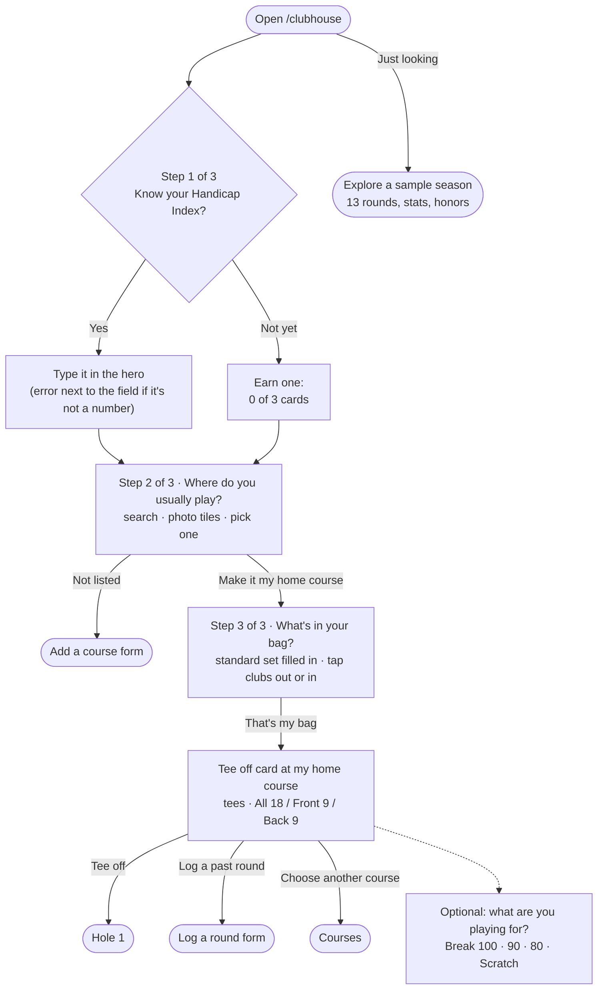
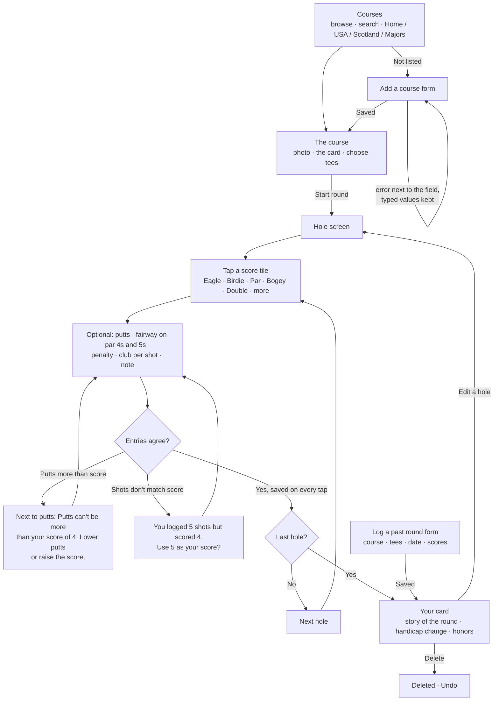
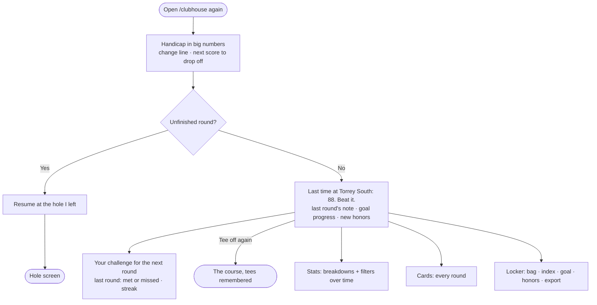

# 18 Eagles

## Assignment 5: Live Data System

18 Eagles now has two live pages. **Tour** shows this week's PGA TOUR leaderboard (ESPN) and the Official World Golf
Ranking (OWGR), with the players you follow first. **Flights** ("Getting there") asks for your location, says which
airport you're near, lets you pick where you're playing (your courses, or any airport), and shows the flights in the
air between the two right now, or says you can drive (adsb.lol positions with adsb.fi as a fallback, routes from adsb.im). Workers on
Supabase fetch each source on a schedule, save only what changed, and record every run. Supabase Realtime then pushes
each change to the open pages, so they update without a refresh. Each golfer chooses what they follow, and row-level
security keeps those choices private.

- **Tour:** https://18-eagles-live.vercel.app/clubhouse/tour
- **Flights:** https://18-eagles-live.vercel.app/clubhouse/flights
- Sign in (any email; your follows and your trip are private to you), follow a player or plan a trip, and leave the
  page open. Flights needs your location; it stays in the browser and only the airport code is saved.
- Diagrams: [`docs/data-flow.md`](docs/data-flow.md) (the chart drawn before code, and the one as built),
  [`flows.md`](flows.md) (user flows, freshness states, one update traced), also on the site's `/flows` page.
  Talking points for class: [`docs/talking-points.md`](docs/talking-points.md).

### The system


### How one change travels
1. **Source.** A player birdies the 7th. ESPN's leaderboard JSON now says -4, thru 7.
2. **Cron.** Every 10 seconds, `pg_cron` runs the `poll-tour` job. `pg_net` POSTs to the Edge Function with the
   `x-worker-secret` header, read from Supabase Vault at that moment.
3. **Worker.** `poll-tour` asks the database whether the secret is right (`worker_secret_ok`). A round is live, so it
   fetches ESPN (8 s timeout) and parses it into one event row and one row per player.
4. **Only what changed.** `diffRows` compares the new rows with the saved ones and returns just his row. The worker
   upserts that one row with the secret key and adds one `worker_runs` row (`ok`, `rows_changed = 1`).
5. **Database to Realtime.** The update goes into Postgres's change log (WAL). `tour_leaderboard` is in the
   `supabase_realtime` publication, so Realtime picks it up.
6. **Realtime to the browser.** For each open Tour page subscribed with `event_id=eq.<id>`, Realtime checks RLS as
   that golfer's Clerk token (select grant + select policy) and sends the row over the WebSocket.
7. **Screen.** `useTourLive` puts the row into React state. The row washes Fairway Tint once (no motion under
   reduced motion). If you follow him, a polite live region reads his new position and score. The `worker_runs`
   insert turns the freshness line to "Updated just now".

### Sources and how we stay under their limits
| Source | What we take | How often | Limits | How we stay under them |
|---|---|---|---|---|
| ESPN leaderboard (`site.web.api.espn.com/apis/site/v2/sports/golf/leaderboard?league=pga`) | this week's event and every player's position, to par, today, thru | every 10 s during a live round (or within 30 min of the first tee time); otherwise at most every 5 min | unpublished; it blocks default User-Agents | one server-side call per tick for every golfer; a real User-Agent; the small leaderboard endpoint (~230 KB, not the ~700 KB scoreboard); idle runs make no call |
| OWGR (`apiweb.owgr.com/.../getRankings`, top 200) | rank, last week's rank, average points | hourly at :07 | unpublished | 24 calls a day; 0 writes when nothing changed (it updates weekly) |
| adsb.lol (`api.adsb.lol/v2/point/{lat}/{lon}/100`, `/v2/hex/{hex,hex…}`) | aircraft within 100 nm of each trip airport; known route flights by hex once they leave both circles | every 30 s: one call per airport in the watched pairs, plus one hex call | dynamic; it rate-limits Supabase's shared egress (we saw 429s) | only the 4 most-shared routes (A↔B is one route), so at most 8 point calls and 1 hex call a run, shared by everyone; no trips = no calls; a 429 never retries in a loop |
| adsb.fi (`opendata.adsb.fi/api/v2/lat/{lat}/lon/{lon}/dist/100`, `/api/v2/hex/{hex}`) | the same data, same field names | only when adsb.lol answers 429 or fails | 1 request a second | calls spaced 1.1 s apart within a run; at most 4 hex fallbacks |
| adsb.im routeset (`POST http://adsb.im/api/0/routeset`, Virtual Radar Server standing data CC0 + adsb.im's additions, ODbL) | a callsign's route: every stop's IATA code and position ("SAN-ORD-SAN"), and whether it's plausible for where the aircraft is | only for airline callsigns with no cached answer | none published; asks for plain http, a contactable User-Agent, and batching | one POST a run with every uncached callsign and its position (chunks of 100, at most 200), climbing/descending aircraft first; cached in `callsign_routes` (`source = 'adsb.im'`) for 7 days (a miss for 1 day); a failure stops that run's lookups. Replaced adsbdb on 2026-11-02, whose terms forbid caching its routes in a database. Cargo and business jets are never looked up. |
| OurAirports | 1,955 airports (code, name, lat/lon) | once, as a seed migration | none (public domain) | it's a table, so the page never calls it |

### Free-tier budget
- **Edge Function calls (Free: 500,000 a month).** `poll-tour` every 10 s = 8,640 a day; `poll-flights` every 30 s =
  2,880; `poll-rankings` hourly = 24. That is 11,544 a day, about **346,000 in 30 days (69%)**. The adsb.fi fallback
  runs inside the same call, so it adds nothing. Idle tour runs still count as calls; they save ESPN calls, not
  Supabase ones.
- **Realtime messages (Free: 2 million a month).** Every change counts once for every open page that receives it.
  - An open Tour page gets 1 `worker_runs` message every 10 s (360 an hour) plus changed leaderboard rows. With no live
    round, that is about 360 an hour. In a live round, about 120 players × 18 holes = ~2,200 row updates over a ~10 h
    day, plus position shifts: roughly 500 more an hour, so **~900 an hour** per open page.
  - An open Flights page now gets 120 run messages an hour plus only its own route's rows (`pair_key=eq.MDW-SAN`):
    a handful of flights, each changing when it moves 5 % along the route or 1,000 ft. The live runs changed 0–2 rows
    each, so **~150–350 an hour** per open page. (The first build's airport boards cost ~5,000–9,000 an hour.)
  - So 2 million is about 6,000 hours of one Flights page, or ~2,000 hours of a Tour page on a live day. Tabs nobody is
    looking at stop listening (useLivePause). If it ever runs hot: pause the `poll-flights` job (below).
- **Database (Free: 500 MB).** 13 MB used. `worker_runs` grows ~11,500 rows a day and a daily job keeps 2 days;
  `cron.job_run_details` keeps 1 day. Live tables stay small (one event, ~120 players, 200 rankings, a few hundred planes).
- Vercel Hobby and Clerk's development instance: unchanged from Assignment 4. No payment method anywhere.

### Freshness rules
The page reads the latest `worker_runs` row for its source, then gets each new run pushed by Realtime
(`source=eq.tour`, `eq.flights`, `eq.rankings`), and re-checks every 5 s (`src/lib/live/useWorkerHealth.ts`).
| State | Rule | The line says |
|---|---|---|
| loading | no answer from the database yet | "Checking for the latest…" |
| fresh | the latest run is ok and the last ok run finished within 3 intervals: **30 s** for the leaderboard, **90 s** for flights, **3 h** for the world ranking | "Updated 8 seconds ago" |
| stale | no ok run within 3 intervals (the worker stopped, or Cron stopped) | "Last updated 2 minutes ago. Waiting for the next update." |
| down | the latest run failed (`ok = false`) | "The feed is down. Showing the last update, from 3 minutes ago." |
An idle tour run (`idle: no live round`) is an ok run: it means the worker is alive and nothing could have changed.
Down holds until the next ok run. A call without the secret writes no run, so a broken secret shows as stale.
Each state has its own drawn mark (dot, ring, struck ring, dashed ring), never colour alone; only state changes are announced.

### Security
- **The Vault secret.** A migration makes `worker_secret` inside the database from `gen_random_bytes(32)`, so no
  person ever sees it. Cron reads it from `vault.decrypted_secrets` at each tick and sends it as `x-worker-secret`.
  The function asks `public.worker_secret_ok(p)` (security definer, empty `search_path`, callable only by
  `service_role`), which answers only true or false. A wrong or missing secret gets 401, and nothing is written.
- **`verify_jwt = false`, on purpose** (`supabase/config.toml`). Cron isn't a user and has no JWT. Turning verification
  on would mean storing a Supabase key in the cron job's SQL. The Vault secret replaces that, and it's checked first.
- **The secret key lives only on Supabase.** Supabase gives it to the Edge Functions on its servers
  (`SUPABASE_SECRET_KEYS`, or `SUPABASE_SERVICE_ROLE_KEY`). It isn't in the code, the repo, Vercel, or the Next.js
  app. The app uses the publishable key plus the golfer's Clerk token, in the browser (`src/lib/live/browser.ts`) and
  in Server Actions (`src/lib/server/follow-actions.ts`).
- **Follows and trips are private.** `followed_players`, `followed_airports` and `trips` have RLS on, with four policies requiring
  `(select auth.jwt())->>'sub' = user_id`. The limits (20 players, 6 airports) are before-insert triggers.
- **Shared tables are read-only.** `tour_*`, `trip_flights`, `trip_pairs`, `airports` and `worker_runs`: RLS on, one select
  policy for `authenticated`, `grant select` only. Only the worker's role (`service_role`) can write.
- **anon gets nothing.** Every new table has `revoke all ... from anon`. Browsers never call ESPN, OWGR, adsb.lol, adsb.fi or adsb.im. `callsign_routes` (the route cache) has RLS on and no policies or grants for anyone but service_role.

### Tests
`npm run test:worker` runs the worker's pure code on saved real responses (`supabase/functions/tests/fixtures/`,
saved 2026-11-02) with Node's test runner. 56 tests pass today.
| File | What it checks |
|---|---|
| `diff.test.ts` | `diffRows`: the same rows twice give 0 upserts and 0 deletes; a first run saves everything; A then B upserts only new and changed rows and deletes the missing one; deletes can be turned off; only listed fields count; composite keys; duplicate keys; database round-trips (`"12.5"` vs `12.5`, `Z` vs `+00:00`) aren't changes |
| `keys.test.ts` | `playerKey`: lowercase dash-joined keys, accents and letters like ø folded, punctuation collapsed, database length limits; the saved ESPN and OWGR responses join on it; the app's copy and the worker's agree on every saved name |
| `tour.test.ts` | ESPN parse on the saved Mexico Open final: event fields, 120 rows, the winner (Andrew Novak, -25), ties ("T2"), a cut player, a withdrawal with no score, no event this week, a changed API throws; a live-round shape; OWGR parse (#1 Scottie Scheffler, points rounded) and a changed API throws; the ESPN-OWGR join; the same response twice writes nothing, one change writes one row; adaptive polling: live fetches every tick, idle waits 5 minutes, the first run fetches, the first tee time beats ESPN's midnight date |
| `flights.test.ts` | The route board on saved real responses (adsb.lol 100 nm around ORD and SAN; adsb.im routeset answers: a small one and 138 callsigns around MDW in one batch): only airline callsigns (no N-numbers, cargo or bizjets); one sighting per aircraft; routeset parse ("UA 2486", SAN → ORD; implausible, unknown and null entries cache as misses; multi-stop routes kept whole, answer order ignored); multi-leg selection (SAN-ORD-SAN, SFO-IAH-DEN-LGA: the leg fitting position, climb and heading); batching (138 callsigns = 2 POSTs of 100 + 38, a failed chunk stops, the time limit stops) and cache reuse; cache lifetimes (7 days, 1 day); pair normalisation (ORD→SAN = SAN→ORD, most-shared first, max 4, drives skipped); route match both ways; phase and progress (departing, en route, arriving, landed, rounded to 5 %; another leg of the same flight number is rejected by climb, descent or track); the lookup budget (≤ 200, unique, cached skipped, moving aircraft first); the whole board on real aircraft, a quiet second run writing nothing, tracking by hex, drops after 10 minutes, landed after 5; adsb.lol → adsb.fi fallback and its 1.1 s spacing. |
| `trip.test.ts` | The suggestion rule on the real airport seed: Fairbanks Ranch and Rancho Santa Fe fly into SAN (not CLD); the Chicago Loop gets MDW (large, 9 mi; ORD is 15); Augusta falls back to AGS (no large airport within 75 mi); Pebble Beach gets SJC over MRY (a large airport within 75 mi wins); far places get a large airport within 250 mi or nothing. |

`npm run test:rls` (Playwright, the Clerk test users) adds three tests to Assignment 4's: followed players, followed
airports, and trips. golfer-a can't see golfer-b's rows, change or delete them, or write one in golfer-b's name (for
trips, neither as an insert nor as an upsert); a signed-out caller gets nothing. 6 passed on 2026-11-03.

### Operating it
Read-only checks in the Supabase SQL editor (or the MCP's `execute_sql`):
```sql
-- The last runs, newest first: is each worker alive, and what did it change?
select source, ok, rows_changed, detail, started_at from public.worker_runs order by started_at desc limit 20;
-- The schedules, and whether each job is on.
select jobid, jobname, schedule, active from cron.job order by jobid;
-- Did Cron's own runs succeed? (pg_net's POST is asynchronous, so "succeeded" means the request was queued.)
select j.jobname, d.status, d.return_message, d.start_time
from cron.job_run_details d join cron.job j using (jobid) order by d.start_time desc limit 10;
-- Failures in the last hour.
select source, count(*) filter (where not ok) as failed, count(*) as runs
from public.worker_runs where started_at > now() - interval '1 hour' group by source;
-- Row counts and the database size.
select (select count(*) from public.tour_leaderboard) as board, (select count(*) from public.trip_flights) as flights,
       (select count(*) from public.callsign_routes) as cached_routes,
       pg_size_pretty(pg_database_size(current_database())) as db;
```
Pause and resume a job (a change to the schedule, so do it as a migration or by hand in the dashboard's Cron page):
```sql
select cron.alter_job((select jobid from cron.job where jobname = 'poll-flights'), active := false);  -- pause
select cron.alter_job((select jobid from cron.job where jobname = 'poll-flights'), active := true);   -- resume
```
While a job is paused, its page goes **stale** within 3 intervals and says so. Nothing else breaks.

Run it locally: `npx next dev -p 3400`, then `/clubhouse/tour` and `/clubhouse/flights`. The workers run only on Supabase.

---

## Assignment 4: Full Stack App (and earlier)

A personal golf round journal, now with your own account. Play a round hole by hole, keep every card, and watch your
handicap move, on every device you sign in on. Built for Design, Build, Ship (MPCS 51238, Autumn 2026),
**Assignment 4: Full Stack App**, extending Assignment 3.

- **The tool:** https://18-eagles-members.vercel.app/clubhouse (make an account; your cards are private to you)
- **Progress hub** (research, mood board, design system, flows): https://18-eagles-members.vercel.app
- Assignment 3 (frozen, localStorage only): https://18-eagles.vercel.app · https://github.com/hewittw/18-eagles

## What's new in Week 4
- **Accounts (Clerk).** Sign up, sign in, sign out. A signed-out visitor sees only the welcome page; every page under
  `/clubhouse/*` requires sign-in (`src/proxy.ts`).
- **Your journal in Supabase, private by Row Level Security.** Three tables (`profiles`, `rounds`, `custom_courses`),
  each row owned by one Clerk user id, with RLS on every table (`supabase/migrations/`). The server talks to Supabase
  with the publishable key + your Clerk token, never a secret key, so Postgres itself decides what you can see.
- **Live course data (OpenGolfAPI) and conditions (Open-Meteo)**, called only from our own server routes
  (`src/app/api/`), with designed loading, nothing-found and API-down states. See [`docs/apis.md`](docs/apis.md).
- **The RLS test**: two golfers each save a card and neither sees the other's. Watched **failing** with RLS broken on
  purpose, then passing: [`docs/rls-test/README.md`](docs/rls-test/README.md). Run: `npm run test:rls`.
- **Security review** on the `full-stack` branch before merging: [`docs/security-review.md`](docs/security-review.md).
- **Instructor feedback addressed:** the add-a-course form fills itself from a course search, with fewer required
  fields; the course photos are graded into one sunlit set; the header recedes as you scroll.
- How it all works, for class: [`docs/talking-points.md`](docs/talking-points.md). Decisions: [`DESIGN_LOG.md`](DESIGN_LOG.md).

## Data model
| table | one row is | owned by |
|---|---|---|
| `profiles` | a golfer's name, index, goal, home course, bag | `user_id` = Clerk `sub` |
| `rounds` | one card (hole-by-hole entries as jsonb, note, weather) | `user_id` |
| `custom_courses` | a course the golfer added | `user_id` |

## User flows

A personal golf round journal. Everything is saved on this device (localStorage).

**The main task, as one sentence:**
> I pick my course → I tee off → I tap my score on each hole (and the clubs, if I want) → I finish → my card is saved and my handicap moves.

## The three flows

1. **First visit:** I open 18 Eagles → three quick questions on the Clubhouse itself, each saved as I answer: my
   Handicap Index (or "Not yet: I'll earn one"), **where I usually play** (pick my home course from photo tiles, or add it),
   and **what's in my bag** (a standard set is filled in; I tap clubs out or in) → the Tee off card opens at *my* course
   with its tees → I tap **Tee off** → I'm on hole 1. (Just looking? "Explore a sample season" fills it with 13 rounds.)
2. **Main task:** I choose a course → I pick my tees → I score each hole (score tiles, putts, fairway, penalties,
   clubs, a note) → after the last hole I see my card, the story of the round, and what changed.
3. **Coming back:** I open 18 Eagles → I see my handicap and how it moved, and any unfinished round to resume → "Last time at
   Torrey South: 88. Beat it." → I tee off at the course I play most, with last round's note in view.

### 1 · First visit (nothing saved)


### 2 · Main task: play a round


### 3 · Coming back


## Routes (a page for each step, one shared nav)
| Route | Step | Nav label |
|---|---|---|
| `/clubhouse` | First visit / coming back home: the handicap, tee off, resume | Clubhouse |
| `/clubhouse/courses` | Choose a course | Courses |
| `/clubhouse/courses/[slug]` | The course, its card, tee choice, start | — |
| `/clubhouse/courses/new` | Form: add a course | — |
| `/clubhouse/rounds/[id]/[hole]` | Playing: the hole screen | — (its own focused header) |
| `/clubhouse/rounds/[id]` | The finished card, the story, what changed | — |
| `/clubhouse/rounds` | Every card (history) | Cards |
| `/clubhouse/rounds/new` | Form: log a round I've played | — |
| `/clubhouse/stats` | Breakdowns with filters | Stats |
| `/clubhouse/locker` | The bag, index and goal, honors, export/reset | Locker |
| `/clubhouse/trophies` | The Trophy Room: this week's case, crystal, career | — (from the Clubhouse and Locker) |

## States and errors we design for
- **Empty:** no rounds → the hero asks three setup questions (index, home course, bag), then the tee off card opens at that course. No blank stats: they show "after 1 round" previews with the goal.
- **One round:** the stats are honest ("1 round") and the handicap tracker reads 1 of 3.
- **In progress:** autosaved on every tap; resume from the clubhouse; the hole screen remembers the last hole.
- **9 holes:** front or back nine; 9-hole scores pair up toward the index.
- **Validation:** putts ≤ score; shot count vs score reconciled; fairway hidden on par 3s; scores 1–15; dates not in the future;
  index −10.0 to 54.0; slope 55–155; rating within reach of par. Every error sits next to its field and says what to do.
- **Destructive:** delete a round → Undo. Erase everything (Locker) → the one confirmation dialog.

## First visit (the onboarding)
Open the tool with nothing saved and it never shows an empty screen or a tour. The Clubhouse itself asks three short
questions, one at a time, and each answer is saved the moment it's given:
1. **Your Handicap Index:** type it (errors sit next to the field), or "Not yet: I'll earn one" (three cards).
2. **Where do you usually play?** Photo tiles of 28 courses (home courses, the PGA majors, Scotland) with search, or
   "My course isn't here" → the Add a course form.
3. **What's in your bag?** A standard 14 is filled in; tap clubs out or in. These become your buttons on every hole.

Then the Tee off card opens at *your* course with its tees, and one tap puts you on hole 1: learning by doing.
Under the question, a showcase for newcomers only: the trophies waiting to be won, a still of the one-tap hole screen,
the handicap worked out for you, the next-round challenge, and course photos from Augusta to St Andrews.
Someone just looking can tap **Explore a sample season** and see the whole app full (13 rounds, stats, honors).
How GHIN, 18Birdies and Arccos onboard, and what we took from each: [`docs/research/`](docs/research/).

## A reason to come back
- **The Trophy Room, every week.** A trophy case at the top of the Clubhouse resets each Monday: the Low Round of
  the Week (your best card this week ranked against all of yours: #1 gold, top 3 silver, top quarter bronze), the Jacket
  (beat your goal this week) and the Challenge Medal. Crystal for eagles, aces and birdie runs, and 22 career trophies
  (Broke 90, Amen Corner, Course Record, Ten Cards…). Thirty in all, worked out from your cards, never stored.
- **Your handicap, moving.** The index in big numbers, how it changed since the last card, your low, and which old
  score your next card will push out of the best 8 of 20.
- **Your challenge for the next round.** After each card, 18 Eagles picks your weakest area from your recent rounds
  (three-putts, doubles, penalties, fairways…) and sets one concrete target. When you come back it says whether you
  met it, and keeps your streak.
- **Beat your last card.** "Last time at Torrey South: 88. Beat it.", with the note you left yourself.
- **Resume.** A round in progress is saved on every tap and waits at the hole you left.
- **New since your last visit.** Trophies won since you were last here are marked New on the shelf.

Everything is saved in localStorage: rounds, the bag, the profile, honors seen, and the time of your last visit.

## Accessibility
- **Keyboard:** every flow was done keyboard-only (skip link, tab order, arrow keys in radio groups, Escape in the
  dialog, focus moved to the new heading after each step and page change). Report: [`docs/verification-keyboard.md`](docs/verification-keyboard.md).
- **Real labels:** every field has a visible `<label>` (search fields have a screen-reader label), hints and errors are
  tied to it with `aria-describedby`, errors are announced and focus moves to the first one, and typed values are kept.
- **Contrast, checked by the agent:** every text/background pair the components use is measured from the design tokens
  (`node --no-warnings src/app/design-system/measure-contrast.mjs`): all pass WCAG AA, and the script fails if the CSS
  drifts. The table is on [/design-system](https://18-eagles.vercel.app/design-system).
- **Automated + sizes:** axe-core on every page in empty, one-round, full-season and mid-round states, at 11 screen
  widths from 320px, with 200% zoom. Report: [`docs/verification.md`](docs/verification.md).
- Scores are never color alone (signs and shapes too), targets are 44px or larger, and motion respects reduced-motion.

## First-run check
An agent used the live site as a brand-new golfer (a 14-handicap from Jackson Park), driving a fresh headless Chromium
with Playwright and empty localStorage. It ran four sessions: a first visit on a phone (name, a wrong index, Back, home
course, bag, three holes by club taps, tiles, putts and a note, then leaving mid-round); coming back later in a new
context to resume, finish, and look at the card, the challenge, the trophies and stats; a laptop pass (adding a course
with errors, logging last week's round); and a keyboard-only pass. Full write-up with screenshots: [`docs/first-run-check.md`](docs/first-run-check.md).

**What it found**
- **Delights:** club taps count the score and putts by themselves ("Through 1 · E"). The Add-a-course form puts each
  error by its field, moves focus there, and keeps what you typed, even across a reload. "Make Jackson Park my home course".
  "Last time at Jackson Park: 81. Beat it."
- **Resuming is buried:** with a round in progress, the hero still says "Your locker is ready", and Resume sits under the
  trophy case, about 1.6 phone screens down. On a first visit, the empty trophy case also pushes Tee off off the screen.
- **Wrong-looking numbers:** the finished card's "White yds" row showed the Blue tee's yards. 9-hole courses said
  "18 holes". After a nine, the challenge said "Your last card was 88" for a 44.
- **Keyboard:** after Tee off or Resume, focus was left on the page body instead of the hole's heading.
- **Dead end:** adding your course from onboarding step 2 left onboarding on step 2, and the new course wasn't in the tiles.

**What we changed**
- Focus now lands on the new page's visible heading after Tee off and Resume (`RouteFocus`).
- The card's yards row shows the tees you played (a shared `yardsAt` helper, also used by the hole screen).
- 9-hole courses read "9 holes" on the card and in Cards. A partial putts total reads "Putts · 3 holes".
- The challenge after a nine says "Shoot 87 or better (44 for nine)" and "works out to 88 over 18 holes".
- Stats say "Track putts on every hole of a round to see this" instead of implying you never tracked them.

Still to do (recommendations in the doc): put Resume in the hero, put Tee off ahead of an empty trophy case, and return
from Add a course to onboarding with the course picked.

## Stack
Next.js 16 (App Router) · Tailwind CSS v4 · Clerk (development instance) · Supabase (Postgres + RLS, Free) · OpenGolfAPI ·
Open-Meteo · Playwright · Vercel Hobby. Charts are hand-built SVG, with no chart library. Course photos are freely
licensed and colour-graded; credits are in [`docs/credits.md`](docs/credits.md). Nothing here costs money.

## Run it
```bash
npm install
# .env.local (you create it; never committed, and the agent is denied reading it):
#   NEXT_PUBLIC_CLERK_PUBLISHABLE_KEY, CLERK_SECRET_KEY, NEXT_PUBLIC_SUPABASE_URL, NEXT_PUBLIC_SUPABASE_PUBLISHABLE_KEY
npx next dev -p 3300   # http://localhost:3300/clubhouse
npm run test:rls       # the two-user RLS test (Clerk test users, code 424242)
```
