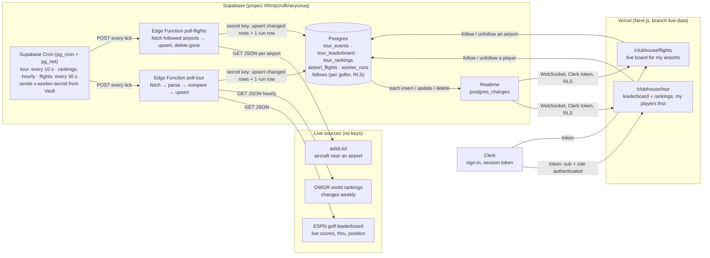
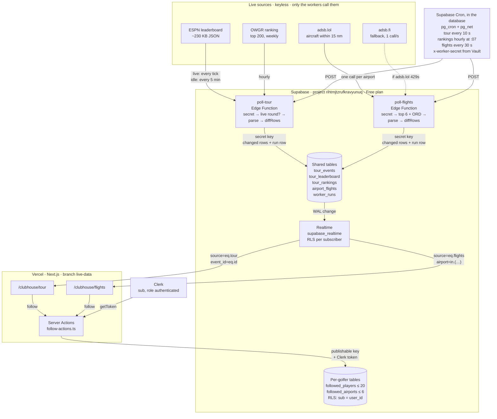

# Assignment 5: Live Data Flow (drawn before any code)

Two live sources, one pattern: a worker on Supabase fetches each source on a schedule, saves **only what changed**,
records every run, and Supabase Realtime pushes each change to the open pages. The browser never calls a source.

## What each part sends to the next, and what breaks if it changes
| Hop | Sends | If it changes |
|---|---|---|
| Source → worker | JSON (ESPN `events[].competitions[].competitors[]`, OWGR `rankingsList[]`, adsb.lol `ac[]`) | A renamed field: the parser skips the row, the run is recorded `ok=false` with the error, the page goes **down** and keeps the last good data. |
| Cron → worker | an HTTP POST with `x-worker-secret` (read from Vault, never in code) | A wrong or missing secret: the worker answers 401 and writes nothing, so the page goes **stale**. |
| Worker → DB | upserts keyed by ID, using the Supabase secret key that Supabase gives the function on its servers | A renamed key column: the upsert duplicates or fails. The test on a saved response catches it. |
| DB → Realtime → page | row changes, filtered by RLS for the signed-in golfer | A missing publication, grant, or policy: the page gets nothing, with no error. Check all three first. |
| Page → DB (follows) | insert/delete in `follows` with the golfer's Clerk token | RLS: each golfer sees and changes only their own follows. |

## Freshness
The page reads the latest `worker_runs` row for its source (and gets new runs pushed by Realtime):
- **loading**: no data yet. **fresh**: the last run worked recently, even if nothing changed.
- **stale**: no successful run within 3 missed intervals. **down**: the last run failed (the last good data stays, marked).

## Free-tier budget
- Edge Function calls: 10 s tour (≈259k/mo) + 30 s flights (≈86k/mo) + hourly rankings (≈720/mo) ≈ 346k of 500k.
- Realtime messages: only changed rows are written, and flight rows are coarsened (altitude to 1,000 ft, distance to 1 nm)
  so tiny moves don't count as changes. Pages subscribe only to the airports they follow.
- adsb.lol: only airports someone follows (max 6), one call each, every 30 s.

---

# As built (2026-11-02)

The chart above is the plan, drawn before any code. It stays as the record. This is the system as it runs now, read
from the code (`supabase/migrations/`, `supabase/functions/`, `src/lib/live/`, the two pages) and checked against the
live project with read-only SQL (`cron.job`, `worker_runs`, `pg_publication_tables`).

`poll-flights` also reads `followed_airports` (which airports to poll) and `airports` (their lat/lon) with the secret
key. The Flights page reads `airports` to suggest the airport nearest each course. Daily trims at 04:17 and 04:23 UTC
keep `worker_runs` to 2 days and `cron.job_run_details` to 1 day.

## What changed from the plan, and why
| Plan (chart above) | As built | Why |
|---|---|---|
| Tour: fetch ESPN every 10 s | Cron still ticks every 10 s, but with no live round the worker calls ESPN at most once every 5 minutes and records `idle: no live round` in between | No live round most of the week. Idle runs still prove the worker is alive (freshness), cost no ESPN call, and write 0 rows. Live round or within 30 min of the first tee time: every tick. |
| "Within 30 minutes of the start time" | Uses the earliest stored tee time, and ESPN's event date only before tee times are posted | ESPN's event date is midnight ET, hours before the first tee shot (about 2,500 wasted calls a week otherwise). |
| One `follows` table | Two tables: `followed_players` (≤ 20) and `followed_airports` (≤ 6), limits in before-insert triggers | Different keys (a name key vs an airport code with a foreign key) and different limits. The database enforces the limits, not only the UI. |
| Flights: adsb.lol only | adsb.lol first, adsb.fi for the same airport when adsb.lol answers 429 or fails (`poll-flights/sources.ts`), adsb.fi calls spaced 1.1 s apart | adsb.lol rate-limits Supabase's shared egress: 2 of the 6 flight runs so far were 429 for every airport (`worker_runs` ids 12 and 47), while the same URL worked from a laptop. |
| Airports: one seed | 1,955 airports in 4 migration files (~40 KB each) | The seed travels to Supabase as text through the MCP, so it is a compact `code|icao|…` block cut into four ~40 KB pieces, each one small enough to send and check. An md5 of the table matched the generator after applying. |
| Flights: poll followed airports | Top 6 by number of followers, plus ORD always (it takes 6th place if needed); boards for airports nobody follows are cleared | A new golfer always sees a live board; Edge Function time and adsb.lol calls stay fixed however many golfers follow. |
| Keep every event | One event at a time: a new week's event deletes last week's (cascade clears its board) | The page shows one event; old rows cost storage and Realtime messages for nothing. |
| Rankings: replace hourly | Hourly; 0 writes when unchanged; deletes only when OWGR sends a full page (≥ 100 rows) | OWGR changes weekly. A short, broken response must not wipe the table. |
| Realtime filtered by follows | Inserts/updates filtered (`event_id=eq.…`, `airport=in.(…)`, `source=eq.…`); deletes unfiltered and dropped in the browser | Supabase Realtime can't filter DELETE events. |
| A run row per run | A run row for every authorised run, ok or not. A request without the secret gets 401 and writes nothing, not even a run | An outsider can't fill `worker_runs` or fake freshness. |
| (not planned) | `cron-history-cleanup` keeps 1 day of `cron.job_run_details` | At ~11,500 cron runs a day it would otherwise grow without limit. |

## Live numbers (read-only SQL, 2026-11-02 20:45 UTC)
- Cron jobs: `poll-tour` `10 seconds`, `poll-rankings` `7 * * * *`, `worker-runs-cleanup` `17 4 * * *`,
  `cron-history-cleanup` `23 4 * * *`, all active. `poll-flights` (`30 seconds`) is in
  `20261102140100_cron_flights.sql`, being applied now; the flight runs so far were test calls.
- 104 runs recorded, 90 of them `idle`, 2 failed (both adsb.lol 429s). Tables: 1 event, 120 leaderboard rows,
  200 rankings, 1,955 airports, 56 live flights. Database: 13 MB of 500 MB.
- Realtime publication: `airport_flights`, `tour_events`, `tour_leaderboard`, `tour_rankings`, `worker_runs`.
