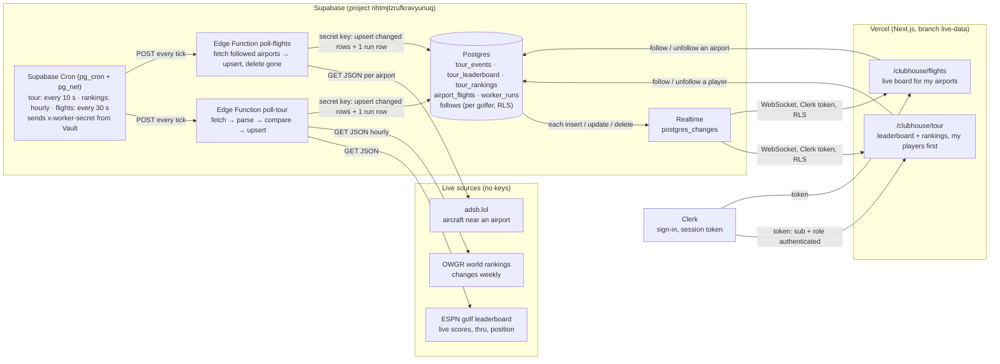

# Assignment 5: Live Data Flow (drawn before any code)

Two live sources, one pattern: a worker on Supabase fetches each source on a schedule, saves **only what changed**,
records every run, and Supabase Realtime pushes each change to the open pages. The browser never calls a source.

## What each part sends to the next, and what breaks if it changes
| Hop | Sends | If it changes |
|---|---|---|
| Source → worker | JSON (ESPN `events[].competitions[].competitors[]`, OWGR `rankingsList[]`, adsb.lol `ac[]`) | A renamed field: the parser skips the row, the run is recorded `ok=false` with the error, the page goes **down** and keeps the last good data. |
| Cron → worker | an HTTP POST with `x-worker-secret` (read from Vault, never in code) | A wrong or missing secret: the worker answers 401 and writes nothing, so the page goes **stale**. |
| Worker → DB | upserts keyed by ID, using the Supabase secret key that Supabase gives the function on its servers | A renamed key column: the upsert duplicates or fails. The test on a saved response catches it. |
| DB → Realtime → page | row changes, filtered by RLS for the signed-in golfer | A missing publication, grant, or policy: the page gets nothing, with no error. Check all three first. |
| Page → DB (follows) | insert/delete in `follows` with the golfer's Clerk token | RLS: each golfer sees and changes only their own follows. |

## Freshness
The page reads the latest `worker_runs` row for its source (and gets new runs pushed by Realtime):
- **loading**: no data yet. **fresh**: the last run worked recently, even if nothing changed.
- **stale**: no successful run within 3 missed intervals. **down**: the last run failed (the last good data stays, marked).

## Free-tier budget
- Edge Function calls: 10 s tour (≈259k/mo) + 30 s flights (≈86k/mo) + hourly rankings (≈720/mo) ≈ 346k of 500k.
- Realtime messages: only changed rows are written, and flight rows are coarsened (altitude to 1,000 ft, distance to 1 nm)
  so tiny moves don't count as changes. Pages subscribe only to the airports they follow.
- adsb.lol: only airports someone follows (max 6), one call each, every 30 s.
