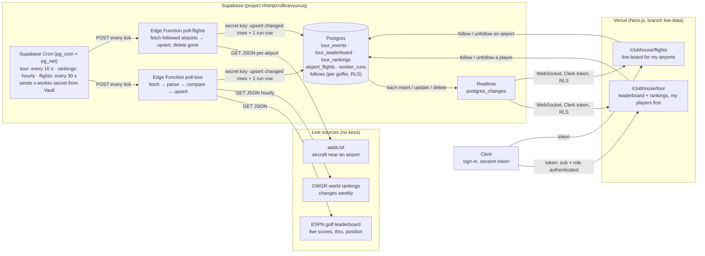
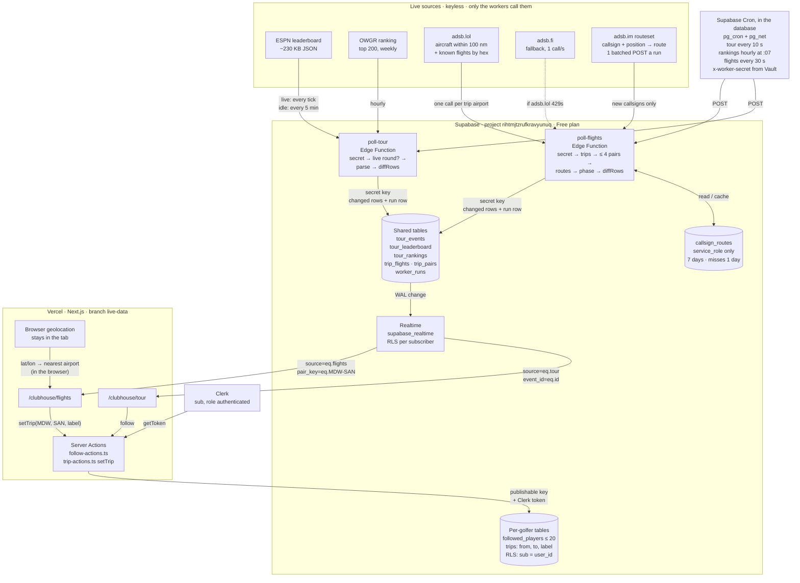
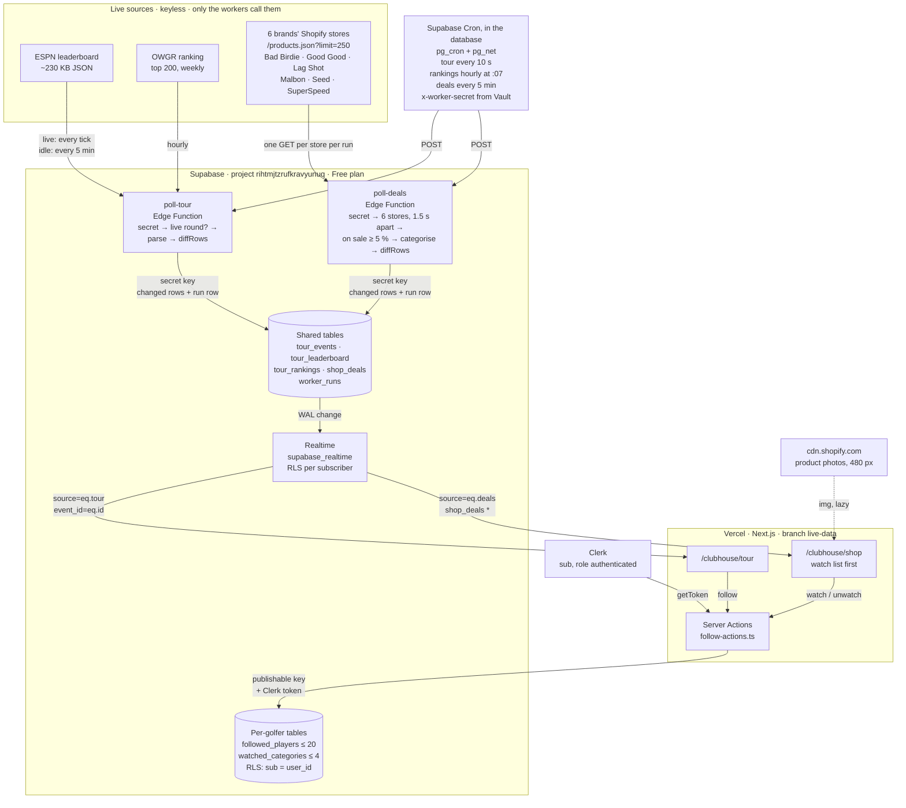

# Assignment 5: Live Data Flow (drawn before any code)

Two live sources, one pattern: a worker on Supabase fetches each source on a schedule, saves **only what changed**,
records every run, and Supabase Realtime pushes each change to the open pages. The browser never calls a source.

## What each part sends to the next, and what breaks if it changes
| Hop | Sends | If it changes |
|---|---|---|
| Source → worker | JSON (ESPN `events[].competitions[].competitors[]`, OWGR `rankingsList[]`, adsb.lol `ac[]`) | A renamed field: the parser skips the row, the run is recorded `ok=false` with the error, the page goes **down** and keeps the last good data. |
| Cron → worker | an HTTP POST with `x-worker-secret` (read from Vault, never in code) | A wrong or missing secret: the worker answers 401 and writes nothing, so the page goes **stale**. |
| Worker → DB | upserts keyed by ID, using the Supabase secret key that Supabase gives the function on its servers | A renamed key column: the upsert duplicates or fails. The test on a saved response catches it. |
| DB → Realtime → page | row changes, filtered by RLS for the signed-in golfer | A missing publication, grant, or policy: the page gets nothing, with no error. Check all three first. |
| Page → DB (follows) | insert/delete in `follows` with the golfer's Clerk token | RLS: each golfer sees and changes only their own follows. |

## Freshness
The page reads the latest `worker_runs` row for its source (and gets new runs pushed by Realtime):
- **loading**: no data yet. **fresh**: the last run worked recently, even if nothing changed.
- **stale**: no successful run within 3 missed intervals. **down**: the last run failed (the last good data stays, marked).

## Free-tier budget
- Edge Function calls: 10 s tour (≈259k/mo) + 30 s flights (≈86k/mo) + hourly rankings (≈720/mo) ≈ 346k of 500k.
- Realtime messages: only changed rows are written, and flight rows are coarsened (altitude to 1,000 ft, distance to 1 nm)
  so tiny moves don't count as changes. Pages subscribe only to the airports they follow.
- adsb.lol: only airports someone follows (max 6), one call each, every 30 s.

---

# As built (2026-11-02), with Flights

> Flights was retired later the same day for the Pro Shop: see **Pivot: Flights → Pro Shop** at the end. This section is
> kept as the record of what ran.

The chart above is the plan, drawn before any code. It stays as the record. This is the system as it runs now, read
from the code (`supabase/migrations/`, `supabase/functions/`, `src/lib/live/`, the two pages) and checked against the
live project with read-only SQL (`cron.job`, `worker_runs`, `pg_publication_tables`).

`poll-flights` also reads `trips` (which routes to watch) and `airports` (their lat/lon) with the secret key. The
Flights page reads `airports` to suggest the airport near the golfer and near each course (one rule, `src/lib/live/suggest.ts`),
in the browser: the request is a lat/lon box snapped to a 2-degree grid, and the coordinates are never sent or stored. Daily trims at 04:17 and 04:23 UTC
keep `worker_runs` to 2 days and `cron.job_run_details` to 1 day.

## What changed from the plan, and why
| Plan (chart above) | As built | Why |
|---|---|---|
| Tour: fetch ESPN every 10 s | Cron still ticks every 10 s, but with no live round the worker calls ESPN at most once every 5 minutes and records `idle: no live round` in between | No live round most of the week. Idle runs still prove the worker is alive (freshness), cost no ESPN call, and write 0 rows. Live round or within 30 min of the first tee time: every tick. |
| "Within 30 minutes of the start time" | Uses the earliest stored tee time, and ESPN's event date only before tee times are posted | ESPN's event date is midnight ET, hours before the first tee shot (about 2,500 wasted calls a week otherwise). |
| One `follows` table | Two tables: `followed_players` (≤ 20) and `followed_airports` (≤ 6), limits in before-insert triggers | Different keys (a name key vs an airport code with a foreign key) and different limits. The database enforces the limits, not only the UI. |
| Flights: adsb.lol only | adsb.lol first, adsb.fi for the same airport when adsb.lol answers 429 or fails (`poll-flights/sources.ts`), adsb.fi calls spaced 1.1 s apart | adsb.lol rate-limits Supabase's shared egress: 2 of the 6 flight runs so far were 429 for every airport (`worker_runs` ids 12 and 47), while the same URL worked from a laptop. |
| Airports: one seed | 1,955 airports in 4 migration files (~40 KB each) | The seed travels to Supabase as text through the MCP, so it is a compact `code|icao|…` block cut into four ~40 KB pieces, each one small enough to send and check. An md5 of the table matched the generator after applying. |
| Flights: poll followed airports | *(First build)* top 6 by followers plus ORD always. *(Rebuilt 2026-11-02 evening)* replaced by trips: see the rows below | The user: the board was "way too huge with all the flights", and "+ Home" / "Follow" were confusing. |
| Flights: a board per followed airport (`airport_flights`, 15 nm) | One board per **route**: `trip_flights` keyed by a sorted pair (`MDW-SAN`), flights flying it in either direction, with phase (departing / en route / arriving / landed) and progress to 5 %. `airport_flights` is no longer written and left the Realtime publication (the table stays) | A golfer wants the flights between where they are and where they're playing, not every plane over an airport. |
| `followed_airports` (≤ 6) | `trips` (one per golfer: from, to, label), saved by `setTrip`; `followed_airports` and its actions stay, unused by the page | One trip is the whole choice; nothing destructive. |
| adsb.lol positions only | Plus a route for each airline callsign, cached in `callsign_routes` (service_role only, 7 days, misses 1 day). *(First build)* adsbdb, at most 30 lookups a run 150 ms apart. *(2026-11-02 night)* **adsb.im's routeset** (`POST /api/0/routeset`): every uncached callsign with its position in one request (chunks of 100, ≤ 200 a run), moving aircraft first; implausible routes count as misses; rows marked `source = 'adsb.im'`, the adsbdb rows deleted; flights that left both 100 nm circles are found by hex in one adsb.lol call (≤ 12 per pair) | Positions alone can't say where a flight is going. The cache warmed in ~5 minutes (403 callsigns), after which runs need 0–3 lookups. adsbdb's terms forbid copying its routes into another database, which the cache did; adsb.im's are VRS standing data (CC0) plus its own additions (ODbL), which allow it. |
| (not planned) | `trip_pairs`: one row per watched pair, written on its first check and when the airlines known to fly it change | The page must tell "finding flights…" from "none in the air", and name the airlines, without reading the private cache. |
| (not planned) | A flight number's other legs are kept off the board: descending into its origin, climbing out of its destination, or at cruise with its track > 100° off the bearing to the destination | Airlines reuse a number all day (WN 3224 MDW→SAN→…): the first live run showed WN 3224 "95% of the way" while climbing out of SAN. adsb.im returns every stop ("SAN-ORD-SAN"), so the worker now picks the leg each aircraft is flying (`pickLeg`: the leg whose phase fits its climb or descent and that it's nearest the line of) with the same rules. |
| Pairs closer than a drive | Not watched (< 150 mi apart); the page says "You can drive this one" | No board, no calls. |
| Keep every event | One event at a time: a new week's event deletes last week's (cascade clears its board) | The page shows one event; old rows cost storage and Realtime messages for nothing. |
| Rankings: replace hourly | Hourly; 0 writes when unchanged; deletes only when OWGR sends a full page (≥ 100 rows) | OWGR changes weekly. A short, broken response must not wipe the table. |
| Realtime filtered by follows | Inserts/updates filtered (`event_id=eq.…`, `airport=in.(…)`, `source=eq.…`); deletes unfiltered and dropped in the browser | Supabase Realtime can't filter DELETE events. |
| A run row per run | A run row for every authorised run, ok or not. A request without the secret gets 401 and writes nothing, not even a run | An outsider can't fill `worker_runs` or fake freshness. |
| (not planned) | `cron-history-cleanup` keeps 1 day of `cron.job_run_details` | At ~11,500 cron runs a day it would otherwise grow without limit. |

## Live numbers (read-only SQL, 2026-11-02 20:45 UTC)
- Cron jobs: `poll-tour` `10 seconds`, `poll-rankings` `7 * * * *`, `worker-runs-cleanup` `17 4 * * *`,
  `cron-history-cleanup` `23 4 * * *`, and `poll-flights` `30 seconds` (applied at 20:55 UTC from
  `20261102140100_cron_flights.sql`; the flight runs before that were test calls), all active.
- 104 runs recorded, 90 of them `idle`, 2 failed (both adsb.lol 429s). Tables: 1 event, 120 leaderboard rows,
  200 rankings, 1,955 airports, 56 live flights. Database: 13 MB of 500 MB.
- Realtime publication: `airport_flights`, `tour_events`, `tour_leaderboard`, `tour_rankings`, `worker_runs`.

## Live numbers after the route rebuild (read-only SQL, 2026-11-03 00:39 UTC)
- `poll-flights` v6, every 30 s. Two trips (golfer-a MDW → SAN, golfer-b ORD → SAN), so two pairs and three airports.
- Runs, newest first: `MDW-SAN 0 flights (2 lookups, 0 tracked), ORD-SAN 2 flights (0 lookups, 0 tracked)` (2.0 s);
  `MDW-SAN 1 flight (1 lookups, 1 tracked), ORD-SAN 2 flights (2 lookups, 0 tracked)` (2.3 s). The first runs on a
  cold cache spent all 30 lookups (≈ 9 s). 0 failed runs in the last hour; the longest took 9.1 s.
- `callsign_routes` 403 (373 found), `trip_flights` 2, `trip_pairs` 2 (ORD-SAN: American, United; MDW-SAN: Southwest).
- Realtime publication: `tour_events`, `tour_leaderboard`, `tour_rankings`, `trip_flights`, `trip_pairs`, `worker_runs`.

---

# Pivot: Flights → Pro Shop (as built, 2026-11-02 late)

Flights was too complicated and too often wrong: free flight data is raw positions only, routes needed licensed or
brittle sources (adsbdb's terms ruled out caching; adsb.im guesses multi-stop routes), and adsb.lol rate-limited
Supabase's shared egress. The second live page is now the **Pro Shop**: what six golf brands have on sale, from each
brand's public Shopify feed, with the categories a golfer watches first. Slickdeals was considered first and ruled out
by its robots.txt and terms (README, "Pivot: Flights → Pro Shop"; per-store terms notes in `docs/credits.md`).
The pattern is unchanged: Cron → worker → only what changed → Realtime → the open page.

## What changed in the pivot, and why
| Before (Flights) | After (Pro Shop) | Why |
|---|---|---|
| `poll-flights` every 30 s: adsb.lol (adsb.fi fallback) + adsb.im routes, ≤ 9 calls a run | `poll-deals` every 5 min: one GET per store, six stores, 1.5 s apart | Sales change over hours, not seconds; one polite request per store is enough, and no source rate-limits us. |
| `trip_flights`, `trip_pairs`, `callsign_routes` | `shop_deals` (id `brand:product`, title, category, price, was_price, pct_off, available, image, url, first_seen_at) | One small table (~140 rows), coarsened so a store re-saving a product isn't a change. |
| `trips` (one per golfer), `followed_airports` | `watched_categories` (≤ 4 of 6, before-insert trigger), the hw4 RLS convention | "Watch Balls" is the golfer's whole choice; less is more. |
| The flights page, geolocation, airport suggestions | `/clubhouse/shop`: a watch list, then everything else with category chips; `/clubhouse/flights` redirects | The user: Flights was "too complicated and isn't working very well." |
| Flights tables in the Realtime publication, cron `poll-flights` | Both removed by `20261102170000_stop_flights.sql`; the tables, rows and the deployed function stay | Nothing destructive without the user. |
| `worker_runs.source` in (tour, rankings, flights) | plus `deals` | One freshness line per source. |
| A failed run = down | A Pro Shop run is ok if any store answered; the failed ones keep their rows and are named in `detail` | One store's outage shouldn't blank the other five, or call the whole shop down. |

## Live numbers after the pivot (read-only SQL, 2026-11-03 04:15 UTC)
- `poll-deals` v1, deployed, then two signed test runs: `138 on sale (bad-birdie 34, good-good 28, lag-shot 55,
  malbon 0, seed 13, superspeed 8) · 138 up, 0 gone` (9.9 s), then the same `· 0 up, 0 gone` (9.1 s). Cron job
  `poll-deals` `*/5 * * * *` active; `poll-flights` unscheduled.
- `shop_deals`: 138 rows (apparel 51, training 62, balls 10, hats 9, bags 6), 10 sold out.
- Realtime publication: `shop_deals`, `tour_events`, `tour_leaderboard`, `tour_rankings`, `worker_runs`.

