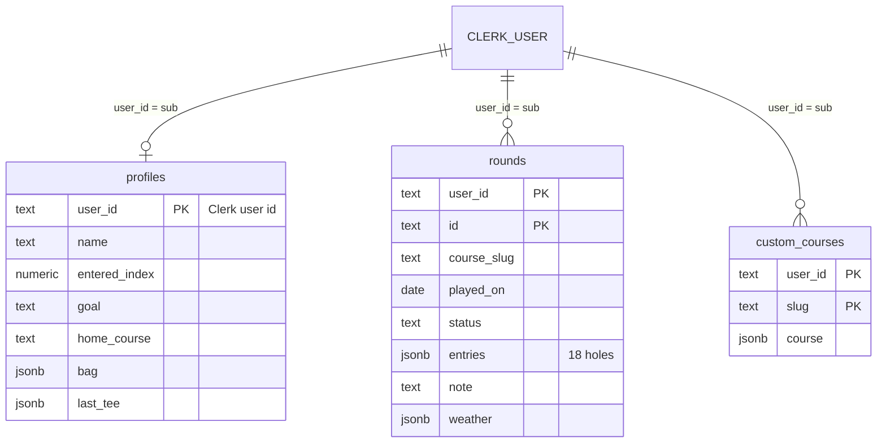
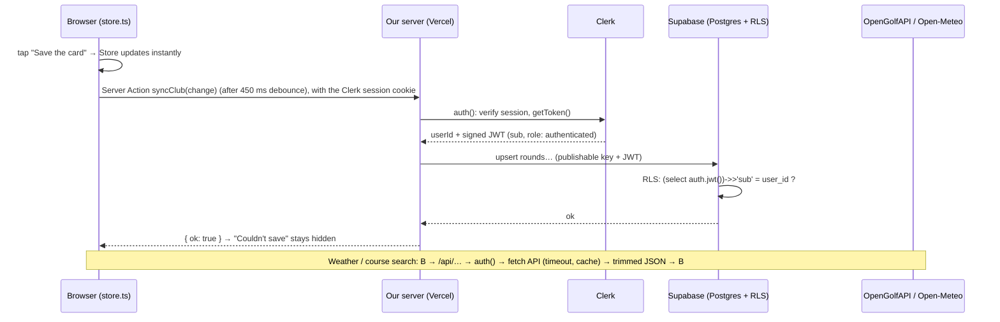

# Talking points: Assignment 5 (live data), then Assignment 4 (full stack)

Answers to every "Ask Your Agent" prompt, and the "Be ready to explain" questions. Short enough to say out loud, with
file paths so you can show the code. The A5 numbers and log lines are real, read with read-only SQL on 2026-11-02.

---

# Assignment 5: Live Data System

## Step 1 · "Explain this response: what each field means, how often it changes, which fields my app needs"
**ESPN leaderboard** (`site.web.api.espn.com/apis/site/v2/sports/golf/leaderboard?league=pga`, ~230 KB). Saved copy:
`supabase/functions/tests/fixtures/espn-leaderboard-mexico-open-final.json`. Parsed in `supabase/functions/poll-tour/parse.ts`.
| Field | Means | Changes | We use it for |
|---|---|---|---|
| `events[].id`, `name`, `shortName`, `date`, `endDate`, `courses[]` | this week's event | once a week | the event band (`tour_events`) |
| `competitions[0].status.type.state` / `.detail`, `status.period` | pre / in / post, "Round 2 - In Progress", the round | a few times a day | the Final/Round pill, and the adaptive polling (`in` = poll every tick) |
| `competitors[].athlete.displayName`, `.id`, `.flag.alt` | the player, ESPN's id, country | never | the name and `player_key` |
| `competitors[].status.position.displayName` | "1", "T5" | after every hole someone plays | position |
| `competitors[].score.displayValue` | total to par, "-25", "E" | after every hole he plays | to par |
| `competitors[].linescores[]` | each round's score | every hole in the current round | "today" |
| `status.displayThru`, `status.teeTime`, `status.type.name` | holes played, tee time, playing/finished/cut/WD | every hole | thru, or his tee time before he starts; cut and WD |
| `sortOrder` | ESPN's order | with positions | the board's order |
We skip the rest: odds, broadcasts, every stroke, player photos.

**OWGR** (`apiweb.owgr.com/api/owgr/rankings/getRankings?...pageSize=200`). Saved copy: `owgr-rankings-top50.json`.
`rankingsList[].rank`, `.lastWeekRank`, `.pointsAverage`, `.player.fullName`, `.player.country.name`. It changes once a
week (Monday). We store rank, last week's rank, average points (to 2 decimals), name and country.

**adsb.lol** (`api.adsb.lol/v2/point/{lat}/{lon}/100`, and `/v2/hex/{hex,hex…}` for flights that left the circles)
and **adsb.fi** (same data, the list is `aircraft` instead of `ac`). Saved copies: `adsblol-ord-100nm.json`,
`adsblol-san-100nm.json` (the route board), `adsbfi-ord.json`; the first build's 15 nm `adsblol-ord-a/b.json` stay.
| Field | Means | Changes | We use it for |
|---|---|---|---|
| `hex` | the aircraft's transponder id | never | the key, with the pair (`MDW-SAN`) |
| `flight`, `r` | callsign (space-padded), registration | per flight | the callsign, and the airline from its first three letters |
| `t` | aircraft type (B738, E75L) | never | the type |
| `alt_baro` ("ground" or feet), `alt_geom` | altitude | every second in the air | rounded to 1,000 ft; "ground" = on the ground |
| `baro_rate`, `geom_rate` | climb or descent, ft/min | every second | the phase on its route (departing, en route, arriving), and spotting another leg of the same flight number |
| `track` | direction over the ground | every second | at cruise, a track more than 100° off the destination means it's on another leg |
| `gs` | ground speed, knots | every second | the ground test (under 200 ft and slower than 50 kt) |
| `lat`, `lon`, `dst` | position, distance from our point in nm | every second | progress along the route (flown ÷ (flown + to go)), rounded to 5 % |
| `now` | the server's time | every call | not stored |

**adsb.im routeset** (`POST http://adsb.im/api/0/routeset`, body `{"planes":[{"callsign":"UAL2486","lat":41.98,"lng":-87.9}, …]}`).
Saved copies: `adsbim-routeset-small.json`, and `adsbim-routeset-mdw-request.json` → `adsbim-routeset-mdw.json` (138
callsigns around Midway in one call, 0.5 s). It answers an array in request order; each entry has `_airport_codes_iata`
("SAN-ORD", or "SAN-ORD-SAN" for one flight number with two legs, or "unknown"), `_airports` (each stop's `iata`,
`lat`, `lon`, name), `airline_code`, `number`, and `plausible` (false when the route doesn't fit where the aircraft is:
a stale or reused callsign). Some entries are `null`. We keep the stops and their positions; implausible, unknown and
null cache as misses. Flight numbers print from the callsign ("UAL2486" → "UA 2486"). Routes change rarely, so each
answer is cached 7 days (a miss 1 day) in `callsign_routes`, which only the worker can read. The data is Virtual Radar
Server's standing data (CC0) plus adsb.im's own ACARS/adsb.lol additions, which adsb.im says are ODbL 1.0.
We drop speed, heading, squawk, signal strength, and everything else, so a plane holding steady isn't a change.

## Step 2 · "List the MCP servers and CLIs you can use, what you'd use each for, and check each one works"
| Tool | Used for | Checked on 2026-11-02 |
|---|---|---|
| Supabase MCP (project `rihtmjtzrufkravyunuq` only) | migrations (`apply_migration`), deploying the functions, read-only checks (`execute_sql` on `worker_runs`, `cron.job`), logs | works: the queries below, and the function logs |
| Playwright MCP and `scripts/shot.mjs` / `shot-as.mjs` | screenshots of the pages, signed in as a test golfer | works: the `/flows` screenshots at 390 and 1440 |
| next-devtools MCP | the installed Next.js docs and dev-server errors | available |
| context7 | library docs (supabase-js, Clerk) | available |
| `gh` | the repo, branches, PRs | works: logged in as hewittw |
| `vercel` | the preview deploy of `live-data`, env vars | works: logged in as hwatkins-1669 |
| `npx clerk` | the dev instance, test users | works: answers, keys read from `.env.local` without printing them |
Never: chrome-devtools MCP or the user's own Chrome.

## Step 3 · "Walk me through the chart: what each part sends to the next, and what would break"
The chart: `docs/data-flow.md` (before code, then as built).
- **Cron → worker:** an HTTP POST every 10 s (tour) or 30 s (flights), with `x-worker-secret` read from Vault.
  *If the secret changed:* the function answers 401 and writes nothing, not even a run, so the page goes **stale**.
- **Worker → source:** a GET with a real User-Agent and an 8 s timeout. *If ESPN renamed a field* (say `events`): the
  parser throws, the run is recorded `ok = false` with the error, the page says **down** and keeps the last good board.
  *If adsb.lol says 429:* that airport tries adsb.fi; if both fail, its board is held and marked. *If adsb.im is down or
  says 429:* lookups stop for that run; cached routes still match, so the board keeps working for known flights.
- **Worker → database:** only changed rows, keyed by `(event_id, player_key)` or `(pair_key, hex)`. *If a key column
  changed:* the upsert fails or duplicates. The tests on saved responses catch the parse side first.
- **Database → Realtime → page:** each change, if the table is in the publication, `authenticated` has `select`, and a
  select policy allows it. *If any one of the three is missing:* the page gets nothing, with no error.
- **Page → database (follows):** a Server Action with the golfer's Clerk token. *If RLS were wrong:* one golfer could see
  another's follows. `npm run test:rls` checks that.

## Step 4 · "Show me the worker's logs from its last three runs, and explain each line"
Three recent rows of `public.worker_runs`, as stored:
```
 id  | source  | ok   | rows_changed | detail                                                                 | started_at (UTC)      | finished_at (UTC)
 180 | tour    | true | 0            | idle: no live round                                                    | 2026-11-02 20:56:06.113 | 20:56:06.288
 178 | flights | true | 51           | CLD 29 lol (+2 −2 ~18), ORD 44 lol (+8 −5 ~16)                         | 2026-11-02 20:55:55.799 | 20:55:56.790
 176 | tour    | true | 0            | VidantaWorld Mexico Open · Final · 120 players · 0 up, 0 gone (idle-refresh) | 2026-11-02 20:55:35.928 | 20:55:36.339
```
The fields: `id` counts up, one per run. `source` is which job (tour, rankings, flights). `ok` is whether it worked;
the page says **down** when the latest one is false. `rows_changed` is how many rows it wrote or deleted, which is
also how many Realtime messages each open page will get. `detail` says what happened in words. `started_at` and
`finished_at` show how long it took; the page counts freshness from `finished_at`.
- **180:** the 10-second tour tick. The Mexico Open is over (state `post`) and the last real ESPN call was under
  5 minutes ago, so the worker didn't call ESPN at all. It still records an ok run (175 ms), which keeps the page fresh.
- **178:** a flights tick from the first build (airport boards, since replaced by routes; a route tick today reads
  `MDW-SAN 1 flight (1 lookups, 1 tracked), ORD-SAN 2 flights (2 lookups, 0 tracked)`). At Carlsbad (CLD), 29 planes within 15 nm, answered by adsb.lol (`lol`; it would say `fi` if
  the fallback answered): 2 new, 2 gone, 18 changed. At O'Hare, 44 planes: 8 new, 5 gone, 16 changed. 2+2+18+8+5+16 = 51.
  The 34 "changed" rows crossed a 1 nm or 1,000 ft line or changed phase; the other planes didn't change and weren't written.
- **176:** the 5-minute refresh while idle: a real ESPN call, 120 players, and nothing changed, so 0 writes and
  0 Realtime messages (411 ms).

The function's own log lines (Supabase function logs) say the same thing:
```
20:55:55.756  booted (time: 33ms)
20:55:56.839  poll-flights: ok rows_changed=51 1040ms · CLD 29 lol (+2 −2 ~18), ORD 44 lol (+8 −5 ~16)
20:55:57.066  poll-tour tour: ok rows_changed=0 135ms · idle: no live round
20:56:06.321  poll-tour tour: ok rows_changed=0 208ms · idle: no live round
20:56:10.727  shutdown
```
`booted` is Supabase starting a worker; `shutdown` is it stopping when idle. Each line in between is one run: the
function, ok or FAILED, rows changed, how long it took, and the same detail as the table.

What we found in the logs earlier: two flight runs failed with **429** from adsb.lol for every airport
(`id 12`: "ORD failed: 429, skipped this tick"; `id 47`: "CLD failed: 429, skipped this tick, ORD failed: 429…"),
while the same URL worked from a laptop. adsb.lol limits Supabase's shared servers. That's why adsb.fi is now the fallback.
Also: the first tour run (`id 1`) wrote 121 rows (the event and 120 players) and the first rankings run 200; the
second rankings run wrote 0 ("200 ranked · unchanged"). That's "only what changed", seen live.

## Step 5 · "Trace one update for me, from the source to my screen, and name every part"
The sequence diagram is flow 7 in `flows.md` (also on `/flows`). Out loud:
1. ESPN: a player birdies the 7th. The JSON now says -4, thru 7.
2. **pg_cron** fires the `poll-tour` job on its 10-second tick.
3. **pg_net** sends the POST to the Edge Function, with the secret read from **Vault**.
4. **poll-tour** checks the secret with `worker_secret_ok`, reads `tour_events`, sees the round is live, and fetches ESPN.
5. **parseLeaderboard** turns the JSON into one event row and 120 player rows.
6. **diffRows** compares them with the saved rows and returns one: his.
7. The worker **upserts** that row into `tour_leaderboard` with the secret key, and inserts one `worker_runs` row.
8. Postgres writes the change to its **WAL**. The table is in the **`supabase_realtime` publication**.
9. **Realtime** finds every open Tour page subscribed with `event_id=eq.<this event>`, checks **RLS** as each golfer's
   Clerk token (select grant + select policy), and sends the change over that page's **WebSocket**.
10. The **browser channel** calls `onRow` in `useTourLive`, which updates **React state**.
11. The **row** re-renders and washes Fairway Tint once. If I follow him, the live region reads his new score.
12. The `worker_runs` insert arrives too, and the freshness line says "Updated just now".

## Step 6 · "Quiz me on how my system works, one question at a time"
Ask these in order, then the four below.
1. *Why doesn't every 10-second run send Realtime messages?* `diffRows` writes only rows that changed, and an idle run writes none.
2. *If you deleted the select policy on `tour_leaderboard`, what would the page show?* Nothing new, with no error: Realtime checks RLS per subscriber.
3. *Where is the Supabase secret key?* Only in the Edge Functions' environment on Supabase. Not in the repo, not on Vercel.
4. *What does the page say if Cron stops?* Stale, within 3 intervals (30 s for the leaderboard). Down needs a failed run.
5. *Why `verify_jwt = false`?* Cron has no user. The Vault secret is the check instead, so no key sits in the cron SQL.
6. *Why round altitude to 1,000 ft?* So a plane holding steady isn't rewritten (and pushed) every 30 seconds.
7. *Two golfers both plan ORD → SAN (or one ORD → SAN, one SAN → ORD). How many calls?* Two adsb.lol point calls a
   tick (one per airport) and at most one hex call, shared: calls are per route, not per golfer. adsb.im (one
   batched POST) only for callsigns not already cached.
8. *Where is my location stored?* Nowhere. The browser turns it into the nearest airport code; only the code is saved
   (`trips.from_airport`). The airport lookup sends a box snapped to a 2-degree grid, not the point.

## Step 7 · "Walk me through the free tier limits for each service, and how to set usage limits and alerts"
| Service | Free limit that matters | Our use | Guard |
|---|---|---|---|
| Supabase Edge Functions | 500,000 calls a month | ~346,000 (10 s + 30 s + hourly) | fixed schedules; the fallback runs inside the same call |
| Supabase Realtime | 2 million messages a month, 200 concurrent connections | ~360/hour per idle Tour page; ~150–350/hour per Flights page (one route; the first build's airport boards were ~5,000–9,000) | only changed rows, coarsened; `pair_key=eq.…` per page; hidden tabs pause; pause `poll-flights` if needed |
| Supabase database | 500 MB | 13 MB | daily trims of `worker_runs` (2 days) and cron history (1 day) |
| Supabase project | pauses after 7 days without use | in use daily | open the app weekly until grades are back |
| Vercel Hobby | as in A4 | unchanged | Hobby can't be billed |
| Clerk development | as in A4 | unchanged | dev keys only |
| ESPN, OWGR | unpublished | ≤ 8,640 ESPN calls a day (live), 288 idle; 24 OWGR | server-side only, one call for everyone |
| adsb.lol / adsb.fi | dynamic / 1 request a second | ≤ 8 airports + 1 hex call every 30 s (4 routes); none with no trips | most-shared four routes; adsb.fi only on failure, spaced 1.1 s |
| adsb.im routeset | none published (asks for http, a contactable User-Agent, batching) | 1 POST a run (≤ 200 callsigns in chunks of 100); none once the cache is warm | 7-day cache; cargo and bizjets never looked up; a failure stops the run's lookups |
**Usage limits and alerts.** Supabase: the Usage page shows Edge Function calls, Realtime messages and database size
for the billing period. With no payment method on the Free plan, nothing can be billed; over a quota, Supabase warns by
email and can restrict the project, it doesn't charge. The spend cap is a Pro setting, so there's nothing to turn on
here. Vercel Hobby: no billing at all; Spend Management is Pro only. Clerk development: no billing. The real guard is the
design: fixed schedules, one call per source for everyone, and writes only on change. No payment method on any account.

---

## Be ready to explain (A5)

**1. Tracing a data change.** "When ESPN posts a birdie, nothing happens until the next 10-second tick. Then Supabase
Cron calls our worker with a secret header. The worker checks the secret, fetches ESPN, turns it into rows, and compares
them with what's saved. Only the changed row is written, plus one row in `worker_runs` saying the run worked. The
database change goes to Realtime, which checks that each open page is allowed to read it and pushes it over the
WebSocket. The page swaps that row into its state, the row glows once, and the freshness line says 'Updated just now'."

**2. The data flow, and what breaks.** "Source, worker, database, Realtime, page. The browser never calls a source.
If ESPN renames a field, the parse fails, the run is saved as failed, and the page says down but keeps the last board.
If the secret is wrong, the worker answers 401 and saves nothing, so the page goes stale. If a table loses its Realtime
publication, grant or policy, the page silently stops updating, so I check those three first. If adsb.lol rate-limits
us, adsb.fi answers for that airport."

**3. Freshness.** "Every run, even an idle one, writes a row in `worker_runs`. The page reads the latest one and gets new
ones pushed. Fresh means the last good run finished within three runs' time: 30 seconds for the leaderboard, 90 for
flights, three hours for the ranking. Stale means no good run in that time. Down means the last run failed. Each state
has its own mark and words, and a screen reader hears only when the state changes."

**4. Agentic workflow: the tests and the logs.** "`npm run test:worker` runs 44 tests on real responses we saved: the
ESPN, OWGR and adsb.lol parses, the player key that joins ESPN to OWGR, the adaptive polling rules, and the diff: the
same response twice writes nothing, and A then B writes exactly what changed. `npm run test:rls` proves one golfer can't
see, delete or forge another's follows. In the logs, the first run wrote 121 rows and later ones wrote 0, which is
'only what changed' working. Most tour runs say 'idle: no live round', with a real ESPN refresh every 5 minutes. And we
found adsb.lol returning 429 to Supabase's servers, which is why we added adsb.fi as the fallback."

---

# Assignment 4 (full stack)

Answers to every "Ask Your Agent" prompt in the brief, and the five "Be ready to explain" questions. Short enough to say
out loud; file paths so you can show the code.

---

## Step 1 · "Explain this response…"
See `docs/apis.md` (one real OpenGolfAPI response and one Open-Meteo response, field by field, and which fields we use).
OpenGolfAPI search with no match returns `{"courses":[],"total":0}`. We show "nothing found" with a next step.

## Step 2 · "Draw a diagram of my tables"

Each row's `user_id` is filled in **by the database** from the caller's Clerk token (`default auth.jwt()->>'sub'`), and
every policy compares it to the token again. A row belongs to exactly one golfer: the one whose `sub` is on it.
Built-in courses (Augusta, Pebble…) are static files, not rows: they belong to nobody.

## Step 3 · "Why does the deny rule protect my keys? Publishable vs secret?"
- `.claude/settings.json` denies `Read(./.env)` and `Read(./.env.*)`. The agent can't open the file, so a key can't
  end up in its context, in a transcript, in a commit, or pasted into a prompt somewhere. (We saw it work: an agent
  command that touched `.env.local` was blocked.) `.gitignore` has `.env*`, so git can't commit it either.
- **Publishable keys** (`NEXT_PUBLIC_CLERK_PUBLISHABLE_KEY`, `NEXT_PUBLIC_SUPABASE_PUBLISHABLE_KEY`) are *meant* to
  reach the browser. They identify the project and grant nothing by themselves: Supabase still requires a valid Clerk
  token, and RLS still applies.
- **Secret keys** (`CLERK_SECRET_KEY`; Supabase's secret/service-role key) can act as admin. Clerk's lives only in
  `.env.local` and Vercel (marked sensitive) and is read only on the server. **We never created or used a Supabase
  secret key at all**, because it bypasses RLS.

## Step 4 · "What did `clerk init` add, file by file?"
| File | What it does |
|---|---|
| `package.json` | adds `@clerk/nextjs` (v7) |
| `src/app/layout.tsx` | wraps the app in `<ClerkProvider>` (inside `<body>`), so every page knows the session |
| `src/proxy.ts` | Next 16's renamed middleware: `clerkMiddleware()` runs on every request and reads the session cookie. We added `auth.protect()` for `/clubhouse/*` |
| `src/app/sign-in/[[...sign-in]]/page.tsx`, `sign-up/…` | catch-all routes hosting Clerk's `<SignIn/>` / `<SignUp/>` (we wrapped them in `<Suspense>` for cacheComponents) |
| `.env.local` | the two Clerk keys (written by the CLI; we never read it) |
| `~/.agents/skills/clerk-*` | Clerk's agent skills (outside the repo) |
Checked signed out: `/clubhouse/stats` → 307 to sign-in; `/clubhouse` shows only the welcome.

## Step 5 · "Explain each RLS policy, and a query it would block"
All 12 policies (3 tables × select/insert/update/delete) are the same rule: **"you may touch a row only if its
`user_id` is your own Clerk id."**
- *read*: you see only your rows. *create*: you can't insert a row labelled as someone else. *update*: you can't edit
  someone else's row, or move your row to them. *delete*: you can't delete theirs.
- A blocked query, run as Avery: `select * from rounds where user_id = 'user_…Blake';` → **0 rows** (not an error:
  Postgres simply hides them). `insert into rounds (user_id, …) values ('user_…Blake', …)` → *new row violates
  row-level security policy*. As a signed-out caller (anon) → *permission denied*: no grants at all.

## Step 6 · "Draw one request, from the click to the screen"


## Step 7 · "Why did the test fail when RLS was broken?" (one sentence)
"With the read policy set to `true`, Postgres returned every golfer's cards to anyone signed in, and because our query
has no filter of its own, Blake's card showed up on Avery's screen, which the test caught." Evidence: `docs/rls-test/`.

## Step 8 · Review and deploy
Branch `full-stack` → `/security-review` → findings and fixes in `docs/security-review.md` → merge to `main` → Vercel
(env vars via `scripts/push-env.sh`) → a classmate signs up.

## Free tiers and limits
| Service | Free limit that matters | Our guard |
|---|---|---|
| Vercel Hobby | 100 GB-hrs functions, 100 GB bandwidth / month; non-commercial | no paid add-ons; Spend Management only exists on Pro, so Hobby can't be billed |
| Supabase Free | 500 MB database, 50k MAU, **pauses after 7 days idle** | open the app weekly until grades are back; no branching (paid) |
| Clerk (development instance) | 100 dev users cap; dev banner | stay on dev keys, as the brief says |
| OpenGolfAPI | 1,000 requests/day per IP, anonymous | all calls go through our routes with a day-long cache |
| Open-Meteo | ~10,000 calls/day, non-commercial | cached ~10 min per location in our route |
No payment method on any account.

---

## Be ready to explain

**1. Trace a save.** Browser: the tap updates the in-memory Store (instant), `store.ts` diffs it against what the
server last confirmed and, after 450 ms, calls the Server Action `syncClub`. Server: `auth()` (Clerk) verifies the
session cookie and mints a JWT; we create a Supabase client with the publishable key and that JWT. Clerk: it's the
identity: the JWT's `sub` is the user id. Supabase: it verifies the JWT against Clerk (Third-Party Auth), runs the
upsert as role `authenticated`, and RLS checks `sub = user_id`. The API: not involved in a save, except a live round
stores the conditions fetched from Open-Meteo (through `/api/weather`) in `rounds.weather`.

**2. Access control.** *Who you are:* Clerk: `clerkMiddleware` in `src/proxy.ts` on every request, `auth()` in every
Server Action and API route. *What you may see:* Postgres RLS, per row, in `supabase/migrations/`. The proxy only
decides which *pages* you can open; even if a page or action had a bug, RLS still returns only your rows (and the test
proves it).

**3. Where API calls happen.** On our server, in route handlers under `src/app/api/`, never in the browser. Why: (a)
**rate limits**: OpenGolfAPI allows 1,000/day per IP, so a shared server cache keeps a whole class under it; (b)
**caching**: course data barely changes (cache a day), weather every ~10 min; (c) **trimming**: OpenGolfAPI's detail is
large, and we send the browser only what we draw; (d) **control**: auth check, input validation, timeouts and one
designed "down" state. Not keys: both APIs are keyless.

**4. The test.** Failing: `✘ golfer-a must NOT see golfer-b's card` (Avery's Cards listed "Blake's private card").
Change: the read policy went from `using (true)` back to `using ((select auth.jwt())->>'sub' = user_id)`. Then 3/3 passed.

**5. What we stopped the agent from doing / what we caught.**
- Stopped: reading `.env*` (deny rule); writing data (`execute_sql` denied; schema only); Supabase branching (paid);
  spending money anywhere; using the user's Chrome; a destructive `drop policy` while the user was away (the MCP
  required a human, so the agent used `alter policy`).
- Caught: Clerk forcing Organizations (every user "pending", so the app looked signed out); a `vercel link` that would
  have overwritten `.env.local` (done in a temp dir instead); the Vercel framework set to "Other" (a 404 site);
  Supabase's `rls_auto_enable()` callable by anyone; per-row `auth.jwt()` in policies; plus the `/security-review`
  findings (see `docs/security-review.md`).
