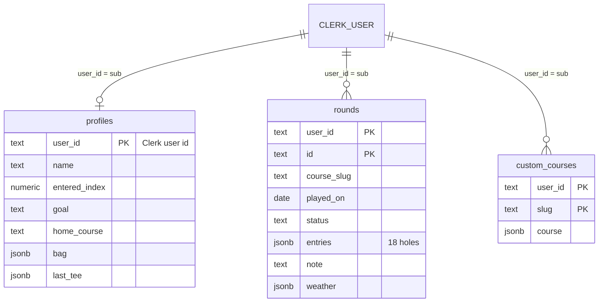
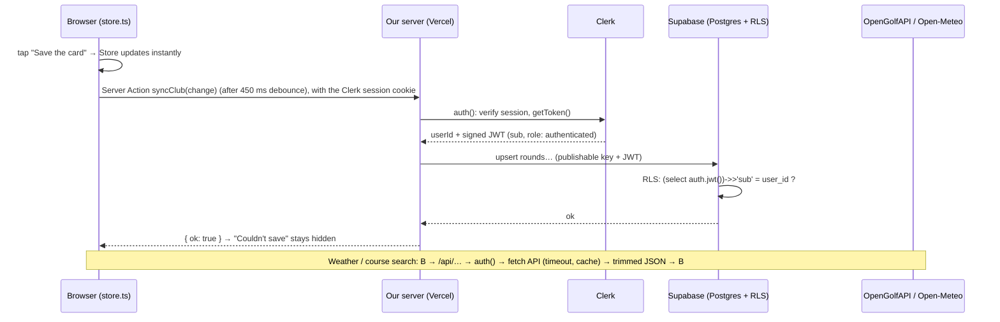

# Talking points: Assignment 5 (live data), then Assignment 4 (full stack)

Answers to every "Ask Your Agent" prompt, and the "Be ready to explain" questions. Short enough to say out loud, with
file paths so you can show the code. The A5 numbers and log lines are real, read with read-only SQL on 2026-11-02.

---

# Assignment 5: Live Data System

## Step 1 · "Explain this response: what each field means, how often it changes, which fields my app needs"
**ESPN leaderboard** (`site.web.api.espn.com/apis/site/v2/sports/golf/leaderboard?league=pga`, ~230 KB). Saved copy:
`supabase/functions/tests/fixtures/espn-leaderboard-mexico-open-final.json`. Parsed in `supabase/functions/poll-tour/parse.ts`.
| Field | Means | Changes | We use it for |
|---|---|---|---|
| `events[].id`, `name`, `shortName`, `date`, `endDate`, `courses[]` | this week's event | once a week | the event band (`tour_events`) |
| `competitions[0].status.type.state` / `.detail`, `status.period` | pre / in / post, "Round 2 - In Progress", the round | a few times a day | the Final/Round pill, and the adaptive polling (`in` = poll every tick) |
| `competitors[].athlete.displayName`, `.id`, `.flag.alt` | the player, ESPN's id, country | never | the name and `player_key` |
| `competitors[].status.position.displayName` | "1", "T5" | after every hole someone plays | position |
| `competitors[].score.displayValue` | total to par, "-25", "E" | after every hole he plays | to par |
| `competitors[].linescores[]` | each round's score | every hole in the current round | "today" |
| `status.displayThru`, `status.teeTime`, `status.type.name` | holes played, tee time, playing/finished/cut/WD | every hole | thru, or his tee time before he starts; cut and WD |
| `sortOrder` | ESPN's order | with positions | the board's order |
We skip the rest: odds, broadcasts, every stroke, player photos.

**OWGR** (`apiweb.owgr.com/api/owgr/rankings/getRankings?...pageSize=200`). Saved copy: `owgr-rankings-top50.json`.
`rankingsList[].rank`, `.lastWeekRank`, `.pointsAverage`, `.player.fullName`, `.player.country.name`. It changes once a
week (Monday). We store rank, last week's rank, average points (to 2 decimals), name and country.

**A brand's Shopify store** (`https://badbirdiegolf.com/products.json?limit=250`, and the same path on the other five
stores; 60 KB–1.2 MB each). Saved copies: `shopify-<brand>-2026-11-02.json` (`body_html` dropped, full-price products
trimmed to 15 per store). Parsed in `supabase/functions/poll-deals/parse.ts`. The response is `{ products: [...] }`:
| Field | Means | Changes | We use it for |
|---|---|---|---|
| `id`, `handle` | Shopify's product id, the URL slug | never | the row id (`bad-birdie:10643538084033`) and the link to `/products/{handle}` |
| `title`, `product_type`, `tags[]` | "Active Bad Hat - Mauve Chalk", "Hat", ["ArchiveSale2026", …] | rarely | the card's name, and the category (title first, then type, then tags, then the brand's fallback) |
| `variants[].price`, `.compare_at_price` | the price now and Shopify's "was" price, as strings ("23.00", "38.00"; `null` = not on sale) | when the brand runs or ends a sale | on sale = was above price by ≥ 5 %; price, was_price, whole-percent off |
| `variants[].available` | in stock | when the last one sells | In stock / Sold out (any on-sale variant in stock = in stock) |
| `variants[].featured_image.src`, `images[0].src` | the photo on `cdn.shopify.com`, with a `?v=` cache-buster | when the brand re-uploads | the card's photo, at a fixed `?width=480`, `?v=` dropped |
| `updated_at`, `published_at`, `vendor`, `options`, `body_html` | housekeeping, the description | `updated_at` constantly | not stored: `updated_at` would make every row "change" every run |
We skip variant sizes and colours, SKUs, weights, and descriptions. A store re-saving a product bumps `updated_at` and
`?v=` all day; neither is stored, so it isn't a change and costs no Realtime message.

*(Retired with Flights: adsb.lol / adsb.fi aircraft positions and adsb.im routes. The README's "Pivot: Flights → Pro
Shop" says why; their saved fixtures and tests were removed with the page.)*

## Step 2 · "List the MCP servers and CLIs you can use, what you'd use each for, and check each one works"
| Tool | Used for | Checked on 2026-11-02 |
|---|---|---|
| Supabase MCP (project `rihtmjtzrufkravyunuq` only) | migrations (`apply_migration`), deploying the functions, read-only checks (`execute_sql` on `worker_runs`, `cron.job`), logs | works: the queries below, and the function logs |
| Playwright MCP and `scripts/shot.mjs` / `shot-as.mjs` | screenshots of the pages, signed in as a test golfer | works: the `/flows` screenshots at 390 and 1440 |
| next-devtools MCP | the installed Next.js docs and dev-server errors | available |
| context7 | library docs (supabase-js, Clerk) | available |
| `gh` | the repo, branches, PRs | works: logged in as hewittw |
| `vercel` | the preview deploy of `live-data`, env vars | works: logged in as hwatkins-1669 |
| `npx clerk` | the dev instance, test users | works: answers, keys read from `.env.local` without printing them |
Never: chrome-devtools MCP or the user's own Chrome.

## Step 3 · "Walk me through the chart: what each part sends to the next, and what would break"
The chart: `docs/data-flow.md` (before code, as built, and after the pivot to the Pro Shop).
- **Cron → worker:** an HTTP POST every 10 s (tour) or every 5 minutes (deals), with `x-worker-secret` read from Vault.
  *If the secret changed:* the function answers 401 and writes nothing, not even a run, so the page goes **stale**.
- **Worker → source:** a GET with a real User-Agent and an 8 s timeout. *If ESPN renamed a field* (say `events`): the
  parser throws, the run is recorded `ok = false` with the error, the page says **down** and keeps the last good board.
  *If one brand's store fails or says 429:* that store keeps its saved cards and the run says so ("kept last for
  malbon HTTP 503"); the run is still ok. Only if all six fail is it recorded `ok = false` (down).
- **Worker → database:** only changed rows, keyed by `(event_id, player_key)` or the deal's `id` (`brand:product`). *If a key column
  changed:* the upsert fails or duplicates. The tests on saved responses catch the parse side first.
- **Database → Realtime → page:** each change, if the table is in the publication, `authenticated` has `select`, and a
  select policy allows it. *If any one of the three is missing:* the page gets nothing, with no error.
- **Page → database (follows):** a Server Action with the golfer's Clerk token. *If RLS were wrong:* one golfer could see
  another's follows. `npm run test:rls` checks that.

## Step 4 · "Show me the worker's logs from its last three runs, and explain each line"
Recent rows of `public.worker_runs`, as stored (2026-11-03 UTC):
```
 id   | source | ok   | rows_changed | detail                                                                                              | started_at   | took
 3737 | deals  | true | 0            | 138 on sale (bad-birdie 34, good-good 28, lag-shot 55, malbon 0, seed 13, superspeed 8) · 0 up, 0 gone   | 04:25:00     | 10.3 s
 3706 | deals  | true | 0            | 138 on sale (… the same) · 0 up, 0 gone                                                               | 04:20:00     | 9.5 s
 3668 | deals  | true | 138          | 138 on sale (bad-birdie 34, good-good 28, lag-shot 55, malbon 0, seed 13, superspeed 8) · 138 up, 0 gone | 04:14:07     | 9.9 s
 3750 | tour   | true | 0            | idle: no live round                                                                                 | 04:27:07.740 | 0.07 s
```
The fields: `id` counts up, one per run. `source` is which job (tour, rankings, deals). `ok` is whether it worked;
the page says **down** when the latest one is false. `rows_changed` is how many rows it wrote or deleted, which is
also how many Realtime messages each open page will get. `detail` says what happened in words. `started_at` and
`finished_at` show how long it took; the page counts freshness from `finished_at`.
- **3668:** the Pro Shop's first run (a signed test call, right after deploying): six stores read one after another,
  1.5 s apart, ~10 s in all. 138 products on sale, and all 138 were new, so 138 written. Malbon answered with nothing
  on sale (0), which is data, not a failure.
- **3706, 3737:** Cron's 5-minute runs. The same 138 on sale and nothing changed in a coarsened field, so 0 writes and
  0 Realtime messages. Only the run row itself is pushed, which moves the freshness line.
- **3750:** the 10-second tour tick. No round is live and the last real ESPN call was under 5 minutes ago, so the
  worker didn't call ESPN at all. It still records an ok run (74 ms), which keeps the Tour page fresh.

Before the pivot, the logs are where we found the problem: two flight runs failed with **429** from adsb.lol for every
airport (`id 12`, `id 47`), while the same URL worked from a laptop. adsb.lol limits Supabase's shared servers, one of
the reasons Flights was retired. Also: the first tour run (`id 1`) wrote 121 rows (the event and 120 players) and the
second rankings run wrote 0 ("200 ranked · unchanged"). That's "only what changed", seen live, on both workers.

## Step 5 · "Trace one update for me, from the source to my screen, and name every part"
The sequence diagram is flow 7 in `flows.md` (also on `/flows`). Out loud:
1. ESPN: a player birdies the 7th. The JSON now says -4, thru 7.
2. **pg_cron** fires the `poll-tour` job on its 10-second tick.
3. **pg_net** sends the POST to the Edge Function, with the secret read from **Vault**.
4. **poll-tour** checks the secret with `worker_secret_ok`, reads `tour_events`, sees the round is live, and fetches ESPN.
5. **parseLeaderboard** turns the JSON into one event row and 120 player rows.
6. **diffRows** compares them with the saved rows and returns one: his.
7. The worker **upserts** that row into `tour_leaderboard` with the secret key, and inserts one `worker_runs` row.
8. Postgres writes the change to its **WAL**. The table is in the **`supabase_realtime` publication**.
9. **Realtime** finds every open Tour page subscribed with `event_id=eq.<this event>`, checks **RLS** as each golfer's
   Clerk token (select grant + select policy), and sends the change over that page's **WebSocket**.
10. The **browser channel** calls `onRow` in `useTourLive`, which updates **React state**.
11. The **row** re-renders and washes Fairway Tint once. If I follow him, the live region reads his new score.
12. The `worker_runs` insert arrives too, and the freshness line says "Updated just now".

## Step 6 · "Quiz me on how my system works, one question at a time"
Ask these in order, then the four below.
1. *Why doesn't every 10-second run send Realtime messages?* `diffRows` writes only rows that changed, and an idle run writes none.
2. *If you deleted the select policy on `tour_leaderboard`, what would the page show?* Nothing new, with no error: Realtime checks RLS per subscriber.
3. *Where is the Supabase secret key?* Only in the Edge Functions' environment on Supabase. Not in the repo, not on Vercel.
4. *What does the page say if Cron stops?* Stale, within 3 intervals (30 s for the leaderboard). Down needs a failed run.
5. *Why `verify_jwt = false`?* Cron has no user. The Vault secret is the check instead, so no key sits in the cron SQL.
6. *Why drop the image's `?v=` and not store `updated_at`?* Shopify bumps both whenever a store re-saves a product, so
   every row would "change" every 5 minutes and push 138 messages to every open page for nothing.
7. *Fifty golfers watch Balls. How many store requests?* Still six a run, one per store, shared by everyone: the worker
   reads the stores, the pages read Supabase.
8. *One store is down. What does the page show?* Its cards stay as they were; the run is still ok and its detail names
   the store. Only if all six fail does the line say down.
9. *Why not Slickdeals?* Its robots.txt disallows the RSS feed and its terms forbid showing its offers on another site
   or reading it by automated means. We read 37 brands' terms and kept the six that don't forbid it.

## Step 7 · "Walk me through the free tier limits for each service, and how to set usage limits and alerts"
| Service | Free limit that matters | Our use | Guard |
|---|---|---|---|
| Supabase Edge Functions | 500,000 calls a month | ~269,000 (10 s + 5 min + hourly; ~346,000 with Flights) | fixed schedules |
| Supabase Realtime | 2 million messages a month, 200 concurrent connections | ~360/hour per idle Tour page; ~15–50/hour per Pro Shop page (12 run rows + changed deals) | only changed rows, coarsened; hidden tabs pause; pause a job if needed |
| Supabase database | 500 MB | 21 MB | daily trims of `worker_runs` (2 days) and cron history (1 day) |
| Supabase project | pauses after 7 days without use | in use daily | open the app weekly until grades are back |
| Vercel Hobby | as in A4 | unchanged | Hobby can't be billed |
| Clerk development | as in A4 | unchanged | dev keys only |
| ESPN, OWGR | unpublished | ≤ 8,640 ESPN calls a day (live), 288 idle; 24 OWGR | server-side only, one call for everyone |
| Six brands' Shopify stores | none published; robots.txt allows `/products.json`; each store's terms checked | 6 requests every 5 min (288 a day per store, 1,728 in all) | one request per store per run, 1.5 s apart, no retries; a failing store keeps its rows |
**Usage limits and alerts.** Supabase: the Usage page shows Edge Function calls, Realtime messages and database size
for the billing period. With no payment method on the Free plan, nothing can be billed; over a quota, Supabase warns by
email and can restrict the project, it doesn't charge. The spend cap is a Pro setting, so there's nothing to turn on
here. Vercel Hobby: no billing at all; Spend Management is Pro only. Clerk development: no billing. The real guard is the
design: fixed schedules, one call per source for everyone, and writes only on change. No payment method on any account.

---

## Be ready to explain (A5)

**1. Tracing a data change.** "When ESPN posts a birdie, nothing happens until the next 10-second tick. Then Supabase
Cron calls our worker with a secret header. The worker checks the secret, fetches ESPN, turns it into rows, and compares
them with what's saved. Only the changed row is written, plus one row in `worker_runs` saying the run worked. The
database change goes to Realtime, which checks that each open page is allowed to read it and pushes it over the
WebSocket. The page swaps that row into its state, the row glows once, and the freshness line says 'Updated just now'."

**2. The data flow, and what breaks.** "Source, worker, database, Realtime, page. The browser never calls a source.
If ESPN renames a field, the parse fails, the run is saved as failed, and the page says down but keeps the last board.
If the secret is wrong, the worker answers 401 and saves nothing, so the page goes stale. If a table loses its Realtime
publication, grant or policy, the page silently stops updating, so I check those three first. If one brand's store is
down, its cards stay and the other five keep updating."

**3. Freshness.** "Every run, even an idle one, writes a row in `worker_runs`. The page reads the latest one and gets new
ones pushed. Fresh means the last good run finished within three runs' time: 30 seconds for the leaderboard, 15 minutes
for the Pro Shop, three hours for the ranking. Stale means no good run in that time. Down means the last run failed. Each state
has its own mark and words, and a screen reader hears only when the state changes."

**4. Agentic workflow: the tests and the logs.** "`npm run test:worker` runs 49 tests on real responses we saved: the
ESPN and OWGR parses, the player key that joins them, the adaptive polling rules, the six stores' feeds (prices, stock,
images, categories, the filters), and the diff: the same response twice writes nothing, and a price drop, a sell-out
and an ended sale write exactly those rows. `npm run test:rls` proves one golfer can't see, delete or forge another's
follows or watch list. In the logs, the Pro Shop's first run wrote 138 rows and every run since wrote 0, which is
'only what changed' working. And the logs are where we found adsb.lol returning 429 to Supabase's servers, one of the
reasons we retired Flights."

**5. The pivot.** "Flights tried to show the flights between you and your course. Free flight data is only positions;
routes came from licensed or guessed sources, adsb.lol rate-limited Supabase's shared servers, and the page got
complicated and was often wrong. We replaced it with the Pro Shop: what golf brands have on sale, from their own public
store feeds. The first idea was Slickdeals, but its robots.txt and terms forbid exactly this, so we read 37 brands'
terms and kept the six that allow it. Same system underneath: Cron, a worker, only changed rows, Realtime."

---

# Assignment 4 (full stack)

Answers to every "Ask Your Agent" prompt in the brief, and the five "Be ready to explain" questions. Short enough to say
out loud; file paths so you can show the code.

---

## Step 1 · "Explain this response…"
See `docs/apis.md` (one real OpenGolfAPI response and one Open-Meteo response, field by field, and which fields we use).
OpenGolfAPI search with no match returns `{"courses":[],"total":0}`. We show "nothing found" with a next step.

## Step 2 · "Draw a diagram of my tables"

Each row's `user_id` is filled in **by the database** from the caller's Clerk token (`default auth.jwt()->>'sub'`), and
every policy compares it to the token again. A row belongs to exactly one golfer: the one whose `sub` is on it.
Built-in courses (Augusta, Pebble…) are static files, not rows: they belong to nobody.

## Step 3 · "Why does the deny rule protect my keys? Publishable vs secret?"
- `.claude/settings.json` denies `Read(./.env)` and `Read(./.env.*)`. The agent can't open the file, so a key can't
  end up in its context, in a transcript, in a commit, or pasted into a prompt somewhere. (We saw it work: an agent
  command that touched `.env.local` was blocked.) `.gitignore` has `.env*`, so git can't commit it either.
- **Publishable keys** (`NEXT_PUBLIC_CLERK_PUBLISHABLE_KEY`, `NEXT_PUBLIC_SUPABASE_PUBLISHABLE_KEY`) are *meant* to
  reach the browser. They identify the project and grant nothing by themselves: Supabase still requires a valid Clerk
  token, and RLS still applies.
- **Secret keys** (`CLERK_SECRET_KEY`; Supabase's secret/service-role key) can act as admin. Clerk's lives only in
  `.env.local` and Vercel (marked sensitive) and is read only on the server. **We never created or used a Supabase
  secret key at all**, because it bypasses RLS.

## Step 4 · "What did `clerk init` add, file by file?"
| File | What it does |
|---|---|
| `package.json` | adds `@clerk/nextjs` (v7) |
| `src/app/layout.tsx` | wraps the app in `<ClerkProvider>` (inside `<body>`), so every page knows the session |
| `src/proxy.ts` | Next 16's renamed middleware: `clerkMiddleware()` runs on every request and reads the session cookie. We added `auth.protect()` for `/clubhouse/*` |
| `src/app/sign-in/[[...sign-in]]/page.tsx`, `sign-up/…` | catch-all routes hosting Clerk's `<SignIn/>` / `<SignUp/>` (we wrapped them in `<Suspense>` for cacheComponents) |
| `.env.local` | the two Clerk keys (written by the CLI; we never read it) |
| `~/.agents/skills/clerk-*` | Clerk's agent skills (outside the repo) |
Checked signed out: `/clubhouse/stats` → 307 to sign-in; `/clubhouse` shows only the welcome.

## Step 5 · "Explain each RLS policy, and a query it would block"
All 12 policies (3 tables × select/insert/update/delete) are the same rule: **"you may touch a row only if its
`user_id` is your own Clerk id."**
- *read*: you see only your rows. *create*: you can't insert a row labelled as someone else. *update*: you can't edit
  someone else's row, or move your row to them. *delete*: you can't delete theirs.
- A blocked query, run as Avery: `select * from rounds where user_id = 'user_…Blake';` → **0 rows** (not an error:
  Postgres simply hides them). `insert into rounds (user_id, …) values ('user_…Blake', …)` → *new row violates
  row-level security policy*. As a signed-out caller (anon) → *permission denied*: no grants at all.

## Step 6 · "Draw one request, from the click to the screen"


## Step 7 · "Why did the test fail when RLS was broken?" (one sentence)
"With the read policy set to `true`, Postgres returned every golfer's cards to anyone signed in, and because our query
has no filter of its own, Blake's card showed up on Avery's screen, which the test caught." Evidence: `docs/rls-test/`.

## Step 8 · Review and deploy
Branch `full-stack` → `/security-review` → findings and fixes in `docs/security-review.md` → merge to `main` → Vercel
(env vars via `scripts/push-env.sh`) → a classmate signs up.

## Free tiers and limits
| Service | Free limit that matters | Our guard |
|---|---|---|
| Vercel Hobby | 100 GB-hrs functions, 100 GB bandwidth / month; non-commercial | no paid add-ons; Spend Management only exists on Pro, so Hobby can't be billed |
| Supabase Free | 500 MB database, 50k MAU, **pauses after 7 days idle** | open the app weekly until grades are back; no branching (paid) |
| Clerk (development instance) | 100 dev users cap; dev banner | stay on dev keys, as the brief says |
| OpenGolfAPI | 1,000 requests/day per IP, anonymous | all calls go through our routes with a day-long cache |
| Open-Meteo | ~10,000 calls/day, non-commercial | cached ~10 min per location in our route |
No payment method on any account.

---

## Be ready to explain

**1. Trace a save.** Browser: the tap updates the in-memory Store (instant), `store.ts` diffs it against what the
server last confirmed and, after 450 ms, calls the Server Action `syncClub`. Server: `auth()` (Clerk) verifies the
session cookie and mints a JWT; we create a Supabase client with the publishable key and that JWT. Clerk: it's the
identity: the JWT's `sub` is the user id. Supabase: it verifies the JWT against Clerk (Third-Party Auth), runs the
upsert as role `authenticated`, and RLS checks `sub = user_id`. The API: not involved in a save, except a live round
stores the conditions fetched from Open-Meteo (through `/api/weather`) in `rounds.weather`.

**2. Access control.** *Who you are:* Clerk: `clerkMiddleware` in `src/proxy.ts` on every request, `auth()` in every
Server Action and API route. *What you may see:* Postgres RLS, per row, in `supabase/migrations/`. The proxy only
decides which *pages* you can open; even if a page or action had a bug, RLS still returns only your rows (and the test
proves it).

**3. Where API calls happen.** On our server, in route handlers under `src/app/api/`, never in the browser. Why: (a)
**rate limits**: OpenGolfAPI allows 1,000/day per IP, so a shared server cache keeps a whole class under it; (b)
**caching**: course data barely changes (cache a day), weather every ~10 min; (c) **trimming**: OpenGolfAPI's detail is
large, and we send the browser only what we draw; (d) **control**: auth check, input validation, timeouts and one
designed "down" state. Not keys: both APIs are keyless.

**4. The test.** Failing: `✘ golfer-a must NOT see golfer-b's card` (Avery's Cards listed "Blake's private card").
Change: the read policy went from `using (true)` back to `using ((select auth.jwt())->>'sub' = user_id)`. Then 3/3 passed.

**5. What we stopped the agent from doing / what we caught.**
- Stopped: reading `.env*` (deny rule); writing data (`execute_sql` denied; schema only); Supabase branching (paid);
  spending money anywhere; using the user's Chrome; a destructive `drop policy` while the user was away (the MCP
  required a human, so the agent used `alter policy`).
- Caught: Clerk forcing Organizations (every user "pending", so the app looked signed out); a `vercel link` that would
  have overwritten `.env.local` (done in a temp dir instead); the Vercel framework set to "Other" (a 404 site);
  Supabase's `rls_auto_enable()` callable by anyone; per-row `auth.jwt()` in policies; plus the `/security-review`
  findings (see `docs/security-review.md`).
