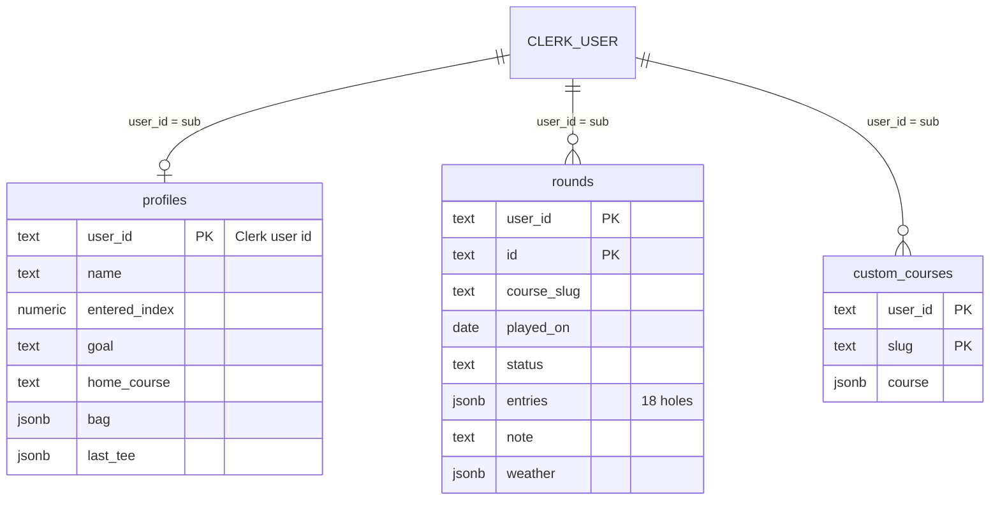
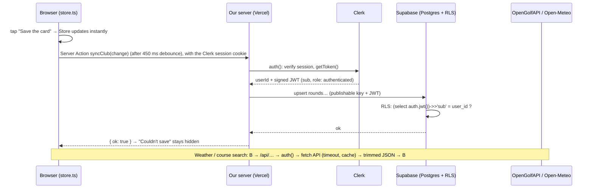

# Talking points: Assignment 4 (18 Eagles, full stack)

Answers to every "Ask Your Agent" prompt in the brief, and the five "Be ready to explain" questions. Short enough to say
out loud; file paths so you can show the code.

---

## Step 1 · "Explain this response…"
See `docs/apis.md` (one real OpenGolfAPI response and one Open-Meteo response, field by field, and which fields we use).
OpenGolfAPI search with no match returns `{"courses":[],"total":0}`. We show "nothing found" with a next step.

## Step 2 · "Draw a diagram of my tables"

Each row's `user_id` is filled in **by the database** from the caller's Clerk token (`default auth.jwt()->>'sub'`), and
every policy compares it to the token again. A row belongs to exactly one golfer: the one whose `sub` is on it.
Built-in courses (Augusta, Pebble…) are static files, not rows: they belong to nobody.

## Step 3 · "Why does the deny rule protect my keys? Publishable vs secret?"
- `.claude/settings.json` denies `Read(./.env)` and `Read(./.env.*)`. The agent can't open the file, so a key can't
  end up in its context, in a transcript, in a commit, or pasted into a prompt somewhere. (We saw it work: an agent
  command that touched `.env.local` was blocked.) `.gitignore` has `.env*`, so git can't commit it either.
- **Publishable keys** (`NEXT_PUBLIC_CLERK_PUBLISHABLE_KEY`, `NEXT_PUBLIC_SUPABASE_PUBLISHABLE_KEY`) are *meant* to
  reach the browser. They identify the project and grant nothing by themselves: Supabase still requires a valid Clerk
  token, and RLS still applies.
- **Secret keys** (`CLERK_SECRET_KEY`; Supabase's secret/service-role key) can act as admin. Clerk's lives only in
  `.env.local` and Vercel (marked sensitive) and is read only on the server. **We never created or used a Supabase
  secret key at all**, because it bypasses RLS.

## Step 4 · "What did `clerk init` add, file by file?"
| File | What it does |
|---|---|
| `package.json` | adds `@clerk/nextjs` (v7) |
| `src/app/layout.tsx` | wraps the app in `<ClerkProvider>` (inside `<body>`), so every page knows the session |
| `src/proxy.ts` | Next 16's renamed middleware: `clerkMiddleware()` runs on every request and reads the session cookie. We added `auth.protect()` for `/clubhouse/*` |
| `src/app/sign-in/[[...sign-in]]/page.tsx`, `sign-up/…` | catch-all routes hosting Clerk's `<SignIn/>` / `<SignUp/>` (we wrapped them in `<Suspense>` for cacheComponents) |
| `.env.local` | the two Clerk keys (written by the CLI; we never read it) |
| `~/.agents/skills/clerk-*` | Clerk's agent skills (outside the repo) |
Checked signed out: `/clubhouse/stats` → 307 to sign-in; `/clubhouse` shows only the welcome.

## Step 5 · "Explain each RLS policy, and a query it would block"
All 12 policies (3 tables × select/insert/update/delete) are the same rule: **"you may touch a row only if its
`user_id` is your own Clerk id."**
- *read*: you see only your rows. *create*: you can't insert a row labelled as someone else. *update*: you can't edit
  someone else's row, or move your row to them. *delete*: you can't delete theirs.
- A blocked query, run as Avery: `select * from rounds where user_id = 'user_…Blake';` → **0 rows** (not an error:
  Postgres simply hides them). `insert into rounds (user_id, …) values ('user_…Blake', …)` → *new row violates
  row-level security policy*. As a signed-out caller (anon) → *permission denied*: no grants at all.

## Step 6 · "Draw one request, from the click to the screen"

## Step 7 · "Why did the test fail when RLS was broken?" (one sentence)
"With the read policy set to `true`, Postgres returned every golfer's cards to anyone signed in, and because our query
has no filter of its own, Blake's card showed up on Avery's screen, which the test caught." Evidence: `docs/rls-test/`.

## Step 8 · Review and deploy
Branch `full-stack` → `/security-review` → findings and fixes in `docs/security-review.md` → merge to `main` → Vercel
(env vars via `scripts/push-env.sh`) → a classmate signs up.

## Free tiers and limits
| Service | Free limit that matters | Our guard |
|---|---|---|
| Vercel Hobby | 100 GB-hrs functions, 100 GB bandwidth / month; non-commercial | no paid add-ons; Spend Management only exists on Pro, so Hobby can't be billed |
| Supabase Free | 500 MB database, 50k MAU, **pauses after 7 days idle** | open the app weekly until grades are back; no branching (paid) |
| Clerk (development instance) | 100 dev users cap; dev banner | stay on dev keys, as the brief says |
| OpenGolfAPI | 1,000 requests/day per IP, anonymous | all calls go through our routes with a day-long cache |
| Open-Meteo | ~10,000 calls/day, non-commercial | cached ~10 min per location in our route |
No payment method on any account.

---

## Be ready to explain

**1. Trace a save.** Browser: the tap updates the in-memory Store (instant), `store.ts` diffs it against what the
server last confirmed and, after 450 ms, calls the Server Action `syncClub`. Server: `auth()` (Clerk) verifies the
session cookie and mints a JWT; we create a Supabase client with the publishable key and that JWT. Clerk: it's the
identity: the JWT's `sub` is the user id. Supabase: it verifies the JWT against Clerk (Third-Party Auth), runs the
upsert as role `authenticated`, and RLS checks `sub = user_id`. The API: not involved in a save, except a live round
stores the conditions fetched from Open-Meteo (through `/api/weather`) in `rounds.weather`.

**2. Access control.** *Who you are:* Clerk: `clerkMiddleware` in `src/proxy.ts` on every request, `auth()` in every
Server Action and API route. *What you may see:* Postgres RLS, per row, in `supabase/migrations/`. The proxy only
decides which *pages* you can open; even if a page or action had a bug, RLS still returns only your rows (and the test
proves it).

**3. Where API calls happen.** On our server, in route handlers under `src/app/api/`, never in the browser. Why: (a)
**rate limits**: OpenGolfAPI allows 1,000/day per IP, so a shared server cache keeps a whole class under it; (b)
**caching**: course data barely changes (cache a day), weather every ~10 min; (c) **trimming**: OpenGolfAPI's detail is
large, and we send the browser only what we draw; (d) **control**: auth check, input validation, timeouts and one
designed "down" state. Not keys: both APIs are keyless.

**4. The test.** Failing: `✘ golfer-a must NOT see golfer-b's card` (Avery's Cards listed "Blake's private card").
Change: the read policy went from `using (true)` back to `using ((select auth.jwt())->>'sub' = user_id)`. Then 3/3 passed.

**5. What we stopped the agent from doing / what we caught.**
- Stopped: reading `.env*` (deny rule); writing data (`execute_sql` denied; schema only); Supabase branching (paid);
  spending money anywhere; using the user's Chrome; a destructive `drop policy` while the user was away (the MCP
  required a human, so the agent used `alter policy`).
- Caught: Clerk forcing Organizations (every user "pending", so the app looked signed out); a `vercel link` that would
  have overwritten `.env.local` (done in a temp dir instead); the Vercel framework set to "Other" (a 404 site);
  Supabase's `rls_auto_enable()` callable by anyone; per-row `auth.jwt()` in policies; plus the `/security-review`
  findings (see `docs/security-review.md`).
