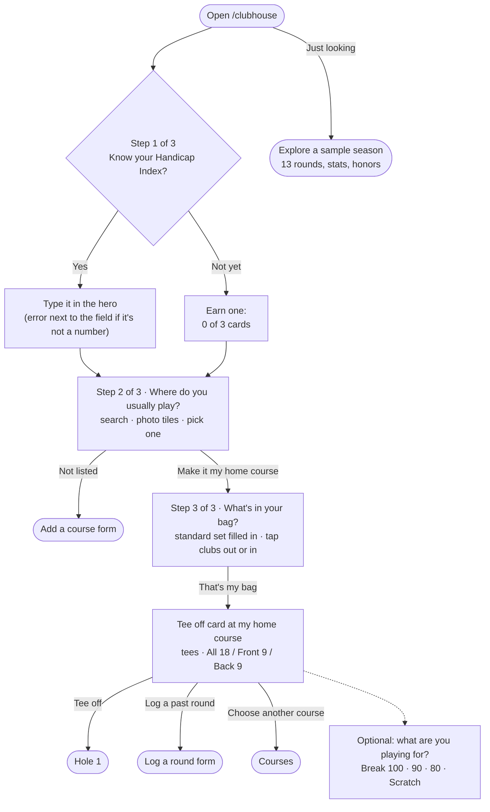
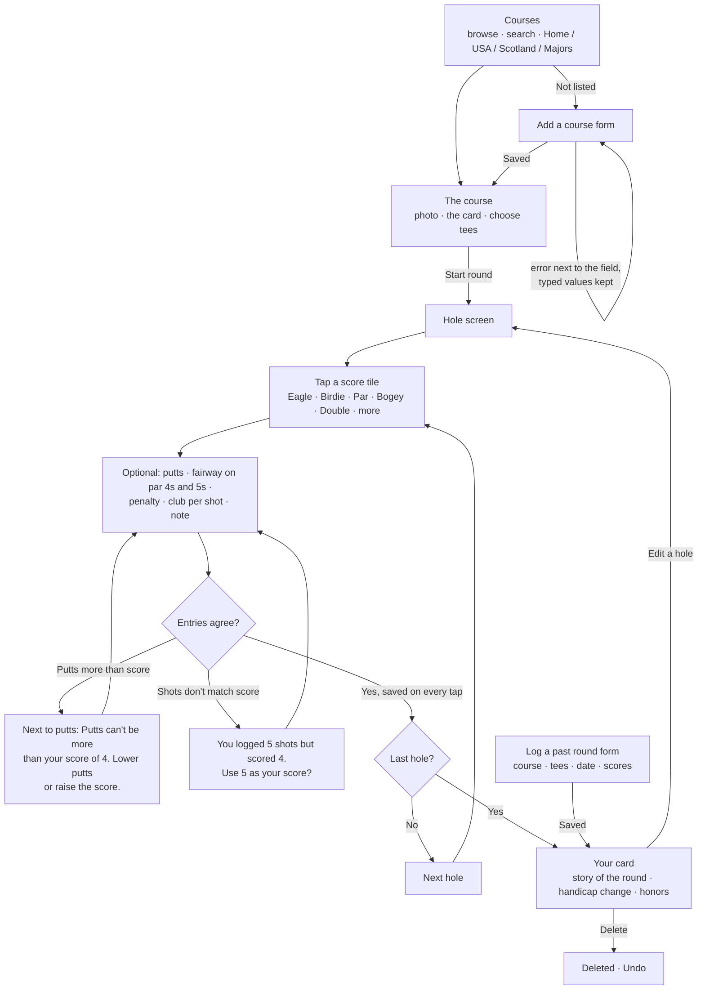
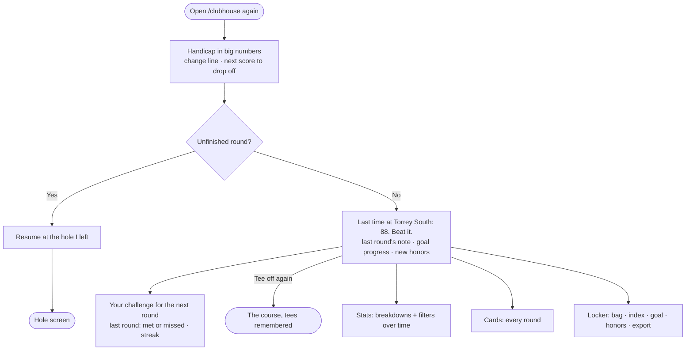
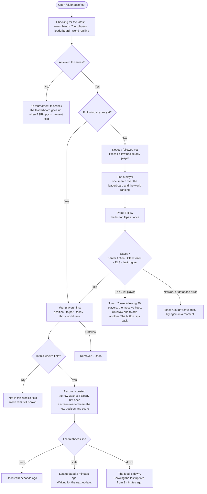
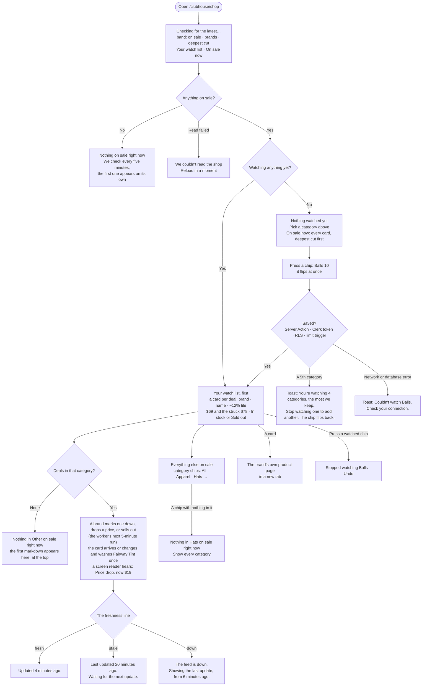
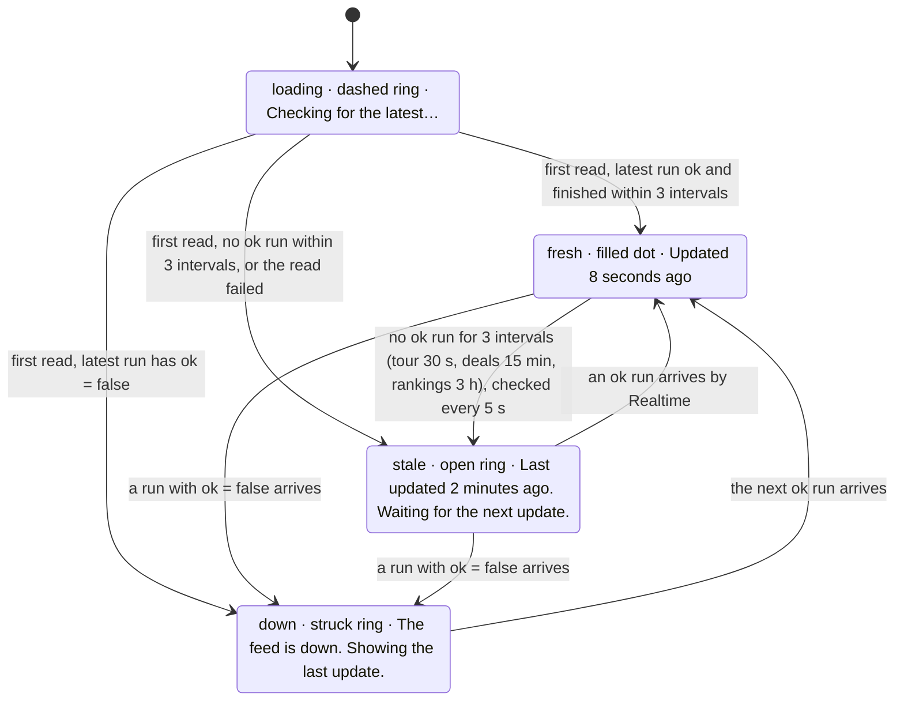
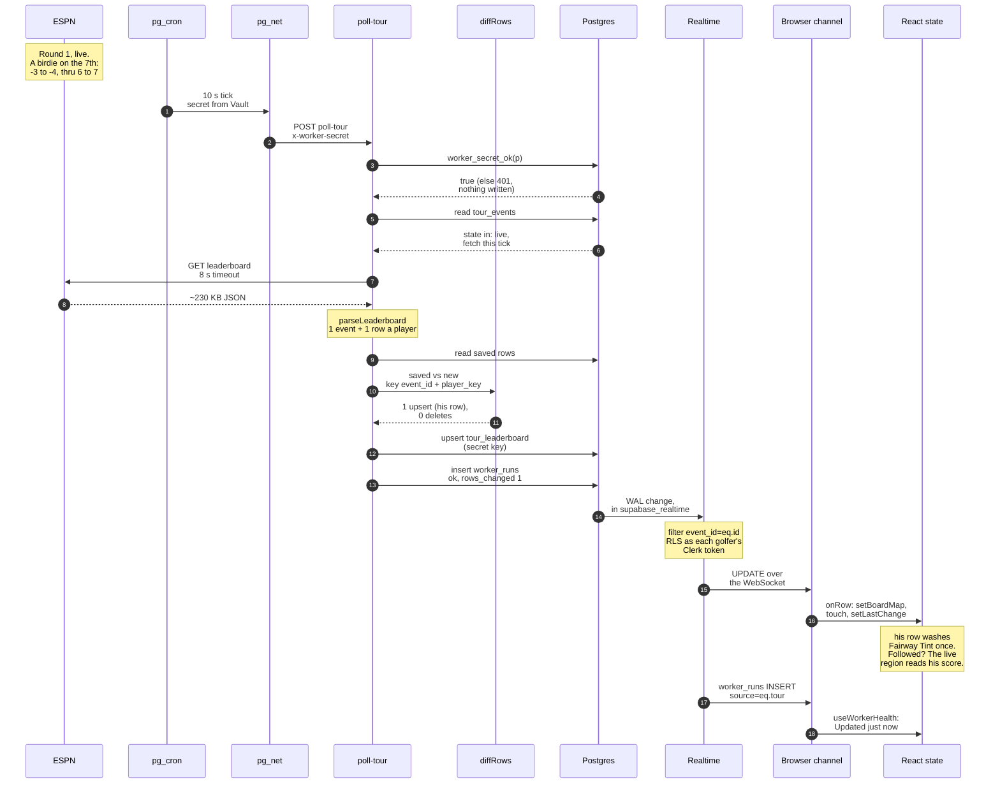

# 18 Eagles · User Flows

A personal golf round journal. Everything is saved on this device (localStorage).

**The main task, as one sentence:**
> I pick my course → I tee off → I tap my score on each hole (and the clubs, if I want) → I finish → my card is saved and my handicap moves.

## The three flows

1. **First visit:** I open 18 Eagles → three quick questions on the Clubhouse itself, each saved as I answer: my
   Handicap Index (or "Not yet: I'll earn one"), **where I usually play** (pick my home course from photo tiles, or add it),
   and **what's in my bag** (a standard set is filled in; I tap clubs out or in) → the Tee off card opens at *my* course
   with its tees → I tap **Tee off** → I'm on hole 1. (Just looking? "Explore a sample season" fills it with 13 rounds.)
2. **Main task:** I choose a course → I pick my tees → I score each hole (score tiles, putts, fairway, penalties,
   clubs, a note) → after the last hole I see my card, the story of the round, and what changed.
3. **Coming back:** I open 18 Eagles → I see my handicap and how it moved, and any unfinished round to resume → "Last time at
   Torrey South: 88. Beat it." → I tee off at the course I play most, with last round's note in view.

### 1 · First visit (nothing saved)

### 2 · Main task: play a round

### 3 · Coming back

## Routes (a page for each step, one shared nav)
| Route | Step | Nav label |
|---|---|---|
| `/clubhouse` | First visit / coming back home: the handicap, tee off, resume | Clubhouse |
| `/clubhouse/courses` | Choose a course | Courses |
| `/clubhouse/courses/[slug]` | The course, its card, tee choice, start | — |
| `/clubhouse/courses/new` | Form: add a course | — |
| `/clubhouse/rounds/[id]/[hole]` | Playing: the hole screen | — (its own focused header) |
| `/clubhouse/rounds/[id]` | The finished card, the story, what changed | — |
| `/clubhouse/rounds` | Every card (history) | Cards |
| `/clubhouse/rounds/new` | Form: log a round I've played | — |
| `/clubhouse/stats` | Breakdowns with filters | Stats |
| `/clubhouse/locker` | The bag, index and goal, honors, export/reset | Locker |
| `/clubhouse/trophies` | The Trophy Room: this week's case, crystal, career | — (from the Clubhouse and Locker) |

## States and errors we design for
- **Empty:** no rounds → the hero asks three setup questions (index, home course, bag), then the tee off card opens at that course. No blank stats: they show "after 1 round" previews with the goal.
- **One round:** the stats are honest ("1 round") and the handicap tracker reads 1 of 3.
- **In progress:** autosaved on every tap; resume from the clubhouse; the hole screen remembers the last hole.
- **9 holes:** front or back nine; 9-hole scores pair up toward the index.
- **Validation:** putts ≤ score; shot count vs score reconciled; fairway hidden on par 3s; scores 1–15; dates not in the future;
  index −10.0 to 54.0; slope 55–155; rating within reach of par. Every error sits next to its field and says what to do.
- **Destructive:** delete a round → Undo. Erase everything (Locker) → the one confirmation dialog.

## Assignment 5: the live system

Two live pages under `/clubhouse`, fed by workers on Supabase: **Tour** (the PGA TOUR leaderboard from ESPN and the
world ranking from OWGR) and the **Pro Shop** (what six golf brands have on sale, from each brand's own public store
feed). Each golfer picks what they follow or watch, and the page updates without a refresh. The Pro Shop replaced
**Flights** on 2026-11-02 (README, "Pivot: Flights → Pro Shop"); `/clubhouse/flights` now redirects to it. The
backend chart, as planned, as built, and after the pivot, is in `docs/data-flow.md`.

### 4 · Follow a tour player and watch them live

### 5 · Watch a category and see new deals live

### 6 · Freshness: what each state looks like

Thresholds, from `src/lib/live/useWorkerHealth.ts`: one interval is the cron schedule, so **fresh** means the last
ok run finished within 30 s for the leaderboard (10 s × 3), 15 minutes for the Pro Shop (5 min × 3) and 3 hours for the world
ranking (1 hour × 3). **Down** wins over the clock: it holds until the next ok run. A request without the worker
secret writes no run at all, so a broken secret shows as **stale**, not down. The line ticks every 5 s; only a change
of state is announced (`aria-live="polite"`).

### 7 · Trace one update: a birdie at the WWT Championship reaches my screen

